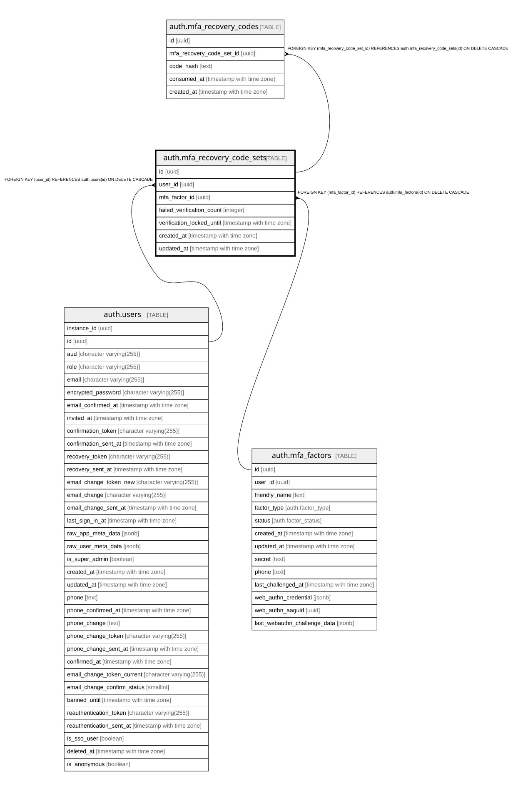

# auth.mfa_recovery_code_sets

## Columns

| Name | Type | Default | Nullable | Children | Parents | Comment |
| ---- | ---- | ------- | -------- | -------- | ------- | ------- |
| id | uuid |  | false | [auth.mfa_recovery_codes](auth.mfa_recovery_codes.md) |  |  |
| user_id | uuid |  | false |  | [auth.users](auth.users.md) |  |
| mfa_factor_id | uuid |  | false |  | [auth.mfa_factors](auth.mfa_factors.md) |  |
| failed_verification_count | integer | 0 | false |  |  |  |
| verification_locked_until | timestamp with time zone |  | true |  |  |  |
| created_at | timestamp with time zone | now() | false |  |  |  |
| updated_at | timestamp with time zone | now() | false |  |  |  |

## Viewpoints

| Name | Definition |
| ---- | ---------- |
| [auth schema](viewpoint-schema-auth.md) | All mapped relations in auth. |

## Constraints

| Name | Type | Definition |
| ---- | ---- | ---------- |
| mfa_recovery_code_sets_failed_verification_count_check | CHECK | CHECK (failed_verification_count >= 0) |
| mfa_recovery_code_sets_mfa_factor_id_fkey | FOREIGN KEY | FOREIGN KEY (mfa_factor_id) REFERENCES auth.mfa_factors(id) ON DELETE CASCADE |
| mfa_recovery_code_sets_mfa_factor_id_key | UNIQUE | UNIQUE (mfa_factor_id) |
| mfa_recovery_code_sets_pkey | PRIMARY KEY | PRIMARY KEY (id) |
| mfa_recovery_code_sets_user_id_fkey | FOREIGN KEY | FOREIGN KEY (user_id) REFERENCES auth.users(id) ON DELETE CASCADE |
| mfa_recovery_code_sets_user_id_key | UNIQUE | UNIQUE (user_id) |

## Indexes

| Name | Definition |
| ---- | ---------- |
| mfa_recovery_code_sets_mfa_factor_id_key | CREATE UNIQUE INDEX mfa_recovery_code_sets_mfa_factor_id_key ON auth.mfa_recovery_code_sets USING btree (mfa_factor_id) |
| mfa_recovery_code_sets_pkey | CREATE UNIQUE INDEX mfa_recovery_code_sets_pkey ON auth.mfa_recovery_code_sets USING btree (id) |
| mfa_recovery_code_sets_user_id_key | CREATE UNIQUE INDEX mfa_recovery_code_sets_user_id_key ON auth.mfa_recovery_code_sets USING btree (user_id) |

## Relations

---

> Generated by [tbls](https://github.com/k1LoW/tbls)
