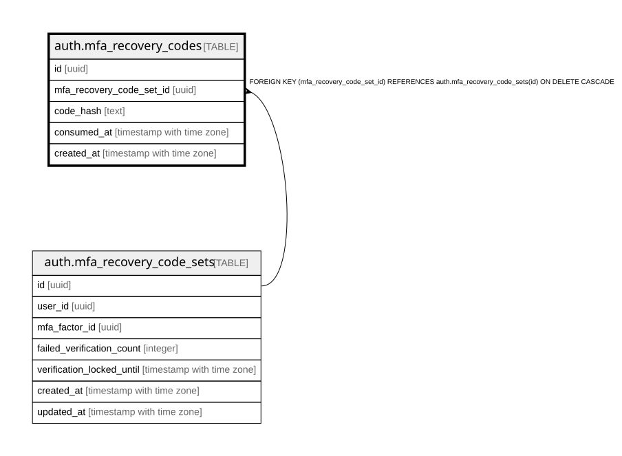

# auth.mfa_recovery_codes

## Columns

| Name | Type | Default | Nullable | Children | Parents | Comment |
| ---- | ---- | ------- | -------- | -------- | ------- | ------- |
| id | uuid |  | false |  |  |  |
| mfa_recovery_code_set_id | uuid |  | false |  | [auth.mfa_recovery_code_sets](auth.mfa_recovery_code_sets.md) |  |
| code_hash | text |  | false |  |  |  |
| consumed_at | timestamp with time zone |  | true |  |  |  |
| created_at | timestamp with time zone | now() | false |  |  |  |

## Viewpoints

| Name | Definition |
| ---- | ---------- |
| [auth schema](viewpoint-schema-auth.md) | All mapped relations in auth. |

## Constraints

| Name | Type | Definition |
| ---- | ---- | ---------- |
| mfa_recovery_codes_mfa_recovery_code_set_id_fkey | FOREIGN KEY | FOREIGN KEY (mfa_recovery_code_set_id) REFERENCES auth.mfa_recovery_code_sets(id) ON DELETE CASCADE |
| mfa_recovery_codes_pkey | PRIMARY KEY | PRIMARY KEY (id) |

## Indexes

| Name | Definition |
| ---- | ---------- |
| mfa_recovery_codes_pkey | CREATE UNIQUE INDEX mfa_recovery_codes_pkey ON auth.mfa_recovery_codes USING btree (id) |
| mfa_recovery_codes_set_id_idx | CREATE INDEX mfa_recovery_codes_set_id_idx ON auth.mfa_recovery_codes USING btree (mfa_recovery_code_set_id) |

## Relations

---

> Generated by [tbls](https://github.com/k1LoW/tbls)
