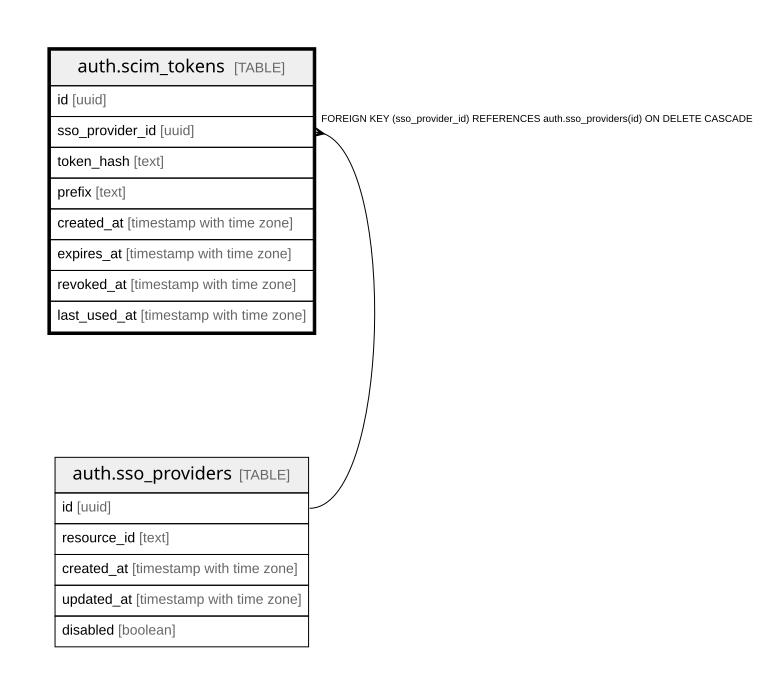

# auth.scim_tokens

## Columns

| Name | Type | Default | Nullable | Children | Parents | Comment |
| ---- | ---- | ------- | -------- | -------- | ------- | ------- |
| id | uuid |  | false |  |  |  |
| sso_provider_id | uuid |  | false |  | [auth.sso_providers](auth.sso_providers.md) |  |
| token_hash | text |  | false |  |  |  |
| prefix | text |  | false |  |  |  |
| created_at | timestamp with time zone | now() | false |  |  |  |
| expires_at | timestamp with time zone |  | true |  |  |  |
| revoked_at | timestamp with time zone |  | true |  |  |  |
| last_used_at | timestamp with time zone |  | true |  |  |  |

## Viewpoints

| Name | Definition |
| ---- | ---------- |
| [auth schema](viewpoint-schema-auth.md) | All mapped relations in auth. |

## Constraints

| Name | Type | Definition |
| ---- | ---- | ---------- |
| scim_tokens_expires_at_future | CHECK | CHECK (expires_at IS NULL OR expires_at > created_at) |
| scim_tokens_pkey | PRIMARY KEY | PRIMARY KEY (id) |
| scim_tokens_revoked_after_created | CHECK | CHECK (revoked_at IS NULL OR revoked_at >= created_at) |
| scim_tokens_sso_provider_id_fkey | FOREIGN KEY | FOREIGN KEY (sso_provider_id) REFERENCES auth.sso_providers(id) ON DELETE CASCADE |
| scim_tokens_token_hash_check | CHECK | CHECK (token_hash ~ '^[0-9a-f]{64}$'::text) |

## Indexes

| Name | Definition |
| ---- | ---------- |
| scim_tokens_expires_at_idx | CREATE INDEX scim_tokens_expires_at_idx ON auth.scim_tokens USING btree (expires_at) |
| scim_tokens_pkey | CREATE UNIQUE INDEX scim_tokens_pkey ON auth.scim_tokens USING btree (id) |
| scim_tokens_revoked_at_idx | CREATE INDEX scim_tokens_revoked_at_idx ON auth.scim_tokens USING btree (revoked_at) |
| scim_tokens_sso_provider_id_idx | CREATE INDEX scim_tokens_sso_provider_id_idx ON auth.scim_tokens USING btree (sso_provider_id) |
| scim_tokens_token_hash_key | CREATE UNIQUE INDEX scim_tokens_token_hash_key ON auth.scim_tokens USING btree (token_hash) |

## Relations

---

> Generated by [tbls](https://github.com/k1LoW/tbls)
