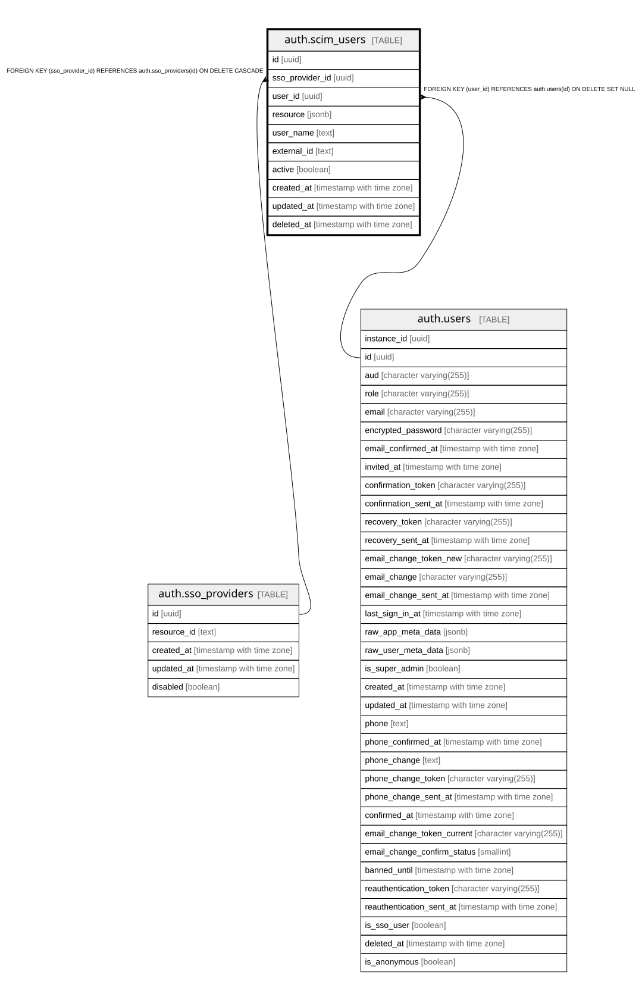

# auth.scim_users

## Columns

| Name | Type | Default | Nullable | Extra Definition | Children | Parents | Comment |
| ---- | ---- | ------- | -------- | ---------------- | -------- | ------- | ------- |
| id | uuid |  | false |  |  |  |  |
| sso_provider_id | uuid |  | false |  |  | [auth.sso_providers](auth.sso_providers.md) |  |
| user_id | uuid |  | true |  |  | [auth.users](auth.users.md) |  |
| resource | jsonb |  | false |  |  |  |  |
| user_name | text | lower((resource -\>\> 'userName'::text)) | false | GENERATED ALWAYS AS STORED |  |  |  |
| external_id | text | (resource -\>\> 'externalId'::text) | true | GENERATED ALWAYS AS STORED |  |  |  |
| active | boolean | COALESCE(((resource -\>\> 'active'::text))::boolean, true) | false | GENERATED ALWAYS AS STORED |  |  |  |
| created_at | timestamp with time zone | now() | false |  |  |  |  |
| updated_at | timestamp with time zone | now() | false |  |  |  |  |
| deleted_at | timestamp with time zone |  | true |  |  |  |  |

## Viewpoints

| Name | Definition |
| ---- | ---------- |
| [auth schema](viewpoint-schema-auth.md) | All mapped relations in auth. |

## Constraints

| Name | Type | Definition |
| ---- | ---- | ---------- |
| scim_users_pkey | PRIMARY KEY | PRIMARY KEY (id) |
| scim_users_sso_provider_id_fkey | FOREIGN KEY | FOREIGN KEY (sso_provider_id) REFERENCES auth.sso_providers(id) ON DELETE CASCADE |
| scim_users_user_id_fkey | FOREIGN KEY | FOREIGN KEY (user_id) REFERENCES auth.users(id) ON DELETE SET NULL |

## Indexes

| Name | Definition |
| ---- | ---------- |
| scim_users_created_at_idx | CREATE INDEX scim_users_created_at_idx ON auth.scim_users USING btree (sso_provider_id, created_at, id) WHERE (deleted_at IS NULL) |
| scim_users_deleted_at_idx | CREATE INDEX scim_users_deleted_at_idx ON auth.scim_users USING btree (deleted_at) |
| scim_users_external_id_key | CREATE UNIQUE INDEX scim_users_external_id_key ON auth.scim_users USING btree (sso_provider_id, external_id) WHERE ((external_id IS NOT NULL) AND (deleted_at IS NULL)) |
| scim_users_id_idx | CREATE INDEX scim_users_id_idx ON auth.scim_users USING btree (sso_provider_id, id) WHERE (deleted_at IS NULL) |
| scim_users_pkey | CREATE UNIQUE INDEX scim_users_pkey ON auth.scim_users USING btree (id) |
| scim_users_sso_provider_id_idx | CREATE INDEX scim_users_sso_provider_id_idx ON auth.scim_users USING btree (sso_provider_id) |
| scim_users_updated_at_idx | CREATE INDEX scim_users_updated_at_idx ON auth.scim_users USING btree (sso_provider_id, updated_at, id) WHERE (deleted_at IS NULL) |
| scim_users_user_id_idx | CREATE INDEX scim_users_user_id_idx ON auth.scim_users USING btree (user_id) |
| scim_users_user_name_idx | CREATE INDEX scim_users_user_name_idx ON auth.scim_users USING btree (sso_provider_id, user_name COLLATE "C", id) WHERE (deleted_at IS NULL) |
| scim_users_user_name_key | CREATE UNIQUE INDEX scim_users_user_name_key ON auth.scim_users USING btree (sso_provider_id, user_name) WHERE (deleted_at IS NULL) |

## Relations

---

> Generated by [tbls](https://github.com/k1LoW/tbls)
