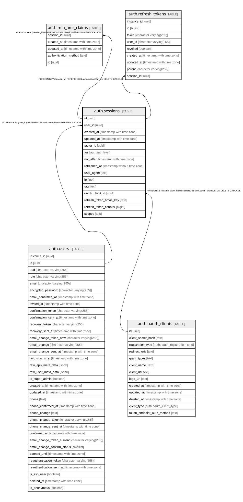

# auth.sessions

## Description

Auth: Stores session data associated to a user.

## Columns

| Name | Type | Default | Nullable | Children | Parents | Comment |
| ---- | ---- | ------- | -------- | -------- | ------- | ------- |
| id | uuid |  | false | [auth.mfa_amr_claims](auth.mfa_amr_claims.md) [auth.refresh_tokens](auth.refresh_tokens.md) |  |  |
| user_id | uuid |  | false |  | [auth.users](auth.users.md) |  |
| created_at | timestamp with time zone |  | true |  |  |  |
| updated_at | timestamp with time zone |  | true |  |  |  |
| factor_id | uuid |  | true |  |  |  |
| aal | auth.aal_level |  | true |  |  |  |
| not_after | timestamp with time zone |  | true |  |  | Auth: Not after is a nullable column that contains a timestamp after which the session should be regarded as expired. |
| refreshed_at | timestamp without time zone |  | true |  |  |  |
| user_agent | text |  | true |  |  |  |
| ip | inet |  | true |  |  |  |
| tag | text |  | true |  |  |  |
| oauth_client_id | uuid |  | true |  | [auth.oauth_clients](auth.oauth_clients.md) |  |
| refresh_token_hmac_key | text |  | true |  |  | Holds a HMAC-SHA256 key used to sign refresh tokens for this session. |
| refresh_token_counter | bigint |  | true |  |  | Holds the ID (counter) of the last issued refresh token. |
| scopes | text |  | true |  |  |  |

## Viewpoints

| Name | Definition |
| ---- | ---------- |
| [auth schema](viewpoint-schema-auth.md) | All mapped relations in auth. |

## Constraints

| Name | Type | Definition |
| ---- | ---- | ---------- |
| sessions_oauth_client_id_fkey | FOREIGN KEY | FOREIGN KEY (oauth_client_id) REFERENCES auth.oauth_clients(id) ON DELETE CASCADE |
| sessions_pkey | PRIMARY KEY | PRIMARY KEY (id) |
| sessions_scopes_length | CHECK | CHECK (char_length(scopes) <= 4096) |
| sessions_user_id_fkey | FOREIGN KEY | FOREIGN KEY (user_id) REFERENCES auth.users(id) ON DELETE CASCADE |

## Indexes

| Name | Definition |
| ---- | ---------- |
| sessions_not_after_idx | CREATE INDEX sessions_not_after_idx ON auth.sessions USING btree (not_after DESC) |
| sessions_oauth_client_id_idx | CREATE INDEX sessions_oauth_client_id_idx ON auth.sessions USING btree (oauth_client_id) |
| sessions_pkey | CREATE UNIQUE INDEX sessions_pkey ON auth.sessions USING btree (id) |
| sessions_user_id_idx | CREATE INDEX sessions_user_id_idx ON auth.sessions USING btree (user_id) |
| user_id_created_at_idx | CREATE INDEX user_id_created_at_idx ON auth.sessions USING btree (user_id, created_at) |

## Relations

---

> Generated by [tbls](https://github.com/k1LoW/tbls)
