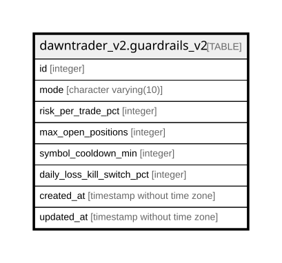

# dawntrader_v2.guardrails_v2

## Columns

| Name | Type | Default | Nullable | Children | Parents | Comment |
| ---- | ---- | ------- | -------- | -------- | ------- | ------- |
| id | integer | nextval('dawntrader_v2.guardrails_v2_id_seq'::regclass) | false |  |  |  |
| mode | character varying(10) |  | false |  |  |  |
| risk_per_trade_pct | integer | 4 | false |  |  |  |
| max_open_positions | integer | 12 | false |  |  |  |
| symbol_cooldown_min | integer | 15 | false |  |  |  |
| daily_loss_kill_switch_pct | integer | 7 | false |  |  |  |
| created_at | timestamp without time zone | now() | true |  |  |  |
| updated_at | timestamp without time zone | now() | true |  |  |  |

## Viewpoints

| Name | Definition |
| ---- | ---------- |
| [dawntrader_v2 schema](viewpoint-schema-dawntrader_v2.md) | All mapped relations in dawntrader_v2. |

## Constraints

| Name | Type | Definition |
| ---- | ---- | ---------- |
| guardrails_mode_unique | UNIQUE | UNIQUE (mode) |
| guardrails_v2_pkey | PRIMARY KEY | PRIMARY KEY (id) |

## Indexes

| Name | Definition |
| ---- | ---------- |
| guardrails_mode_unique | CREATE UNIQUE INDEX guardrails_mode_unique ON dawntrader_v2.guardrails_v2 USING btree (mode) |
| guardrails_v2_pkey | CREATE UNIQUE INDEX guardrails_v2_pkey ON dawntrader_v2.guardrails_v2 USING btree (id) |
| idx_guardrails_mode | CREATE INDEX idx_guardrails_mode ON dawntrader_v2.guardrails_v2 USING btree (mode) |

## Relations

---

> Generated by [tbls](https://github.com/k1LoW/tbls)
