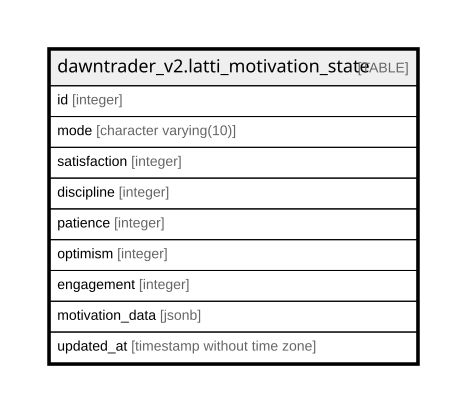

# dawntrader_v2.latti_motivation_state

## Columns

| Name | Type | Default | Nullable | Children | Parents | Comment |
| ---- | ---- | ------- | -------- | -------- | ------- | ------- |
| id | integer | nextval('dawntrader_v2.latti_motivation_state_id_seq'::regclass) | false |  |  |  |
| mode | character varying(10) |  | false |  |  |  |
| satisfaction | integer | 50 | true |  |  |  |
| discipline | integer | 50 | true |  |  |  |
| patience | integer | 50 | true |  |  |  |
| optimism | integer | 50 | true |  |  |  |
| engagement | integer | 50 | true |  |  |  |
| motivation_data | jsonb |  | true |  |  |  |
| updated_at | timestamp without time zone | now() | true |  |  |  |

## Viewpoints

| Name | Definition |
| ---- | ---------- |
| [dawntrader_v2 schema](viewpoint-schema-dawntrader_v2.md) | All mapped relations in dawntrader_v2. |

## Constraints

| Name | Type | Definition |
| ---- | ---- | ---------- |
| latti_motivation_state_pkey | PRIMARY KEY | PRIMARY KEY (id) |

## Indexes

| Name | Definition |
| ---- | ---------- |
| latti_motivation_state_pkey | CREATE UNIQUE INDEX latti_motivation_state_pkey ON dawntrader_v2.latti_motivation_state USING btree (id) |

## Relations

---

> Generated by [tbls](https://github.com/k1LoW/tbls)
