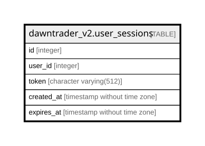

# dawntrader_v2.user_sessions

## Columns

| Name | Type | Default | Nullable | Children | Parents | Comment |
| ---- | ---- | ------- | -------- | -------- | ------- | ------- |
| id | integer | nextval('dawntrader_v2.user_sessions_id_seq'::regclass) | false |  |  |  |
| user_id | integer |  | false |  |  |  |
| token | character varying(512) |  | false |  |  |  |
| created_at | timestamp without time zone | now() | true |  |  |  |
| expires_at | timestamp without time zone |  | false |  |  |  |

## Viewpoints

| Name | Definition |
| ---- | ---------- |
| [dawntrader_v2 schema](viewpoint-schema-dawntrader_v2.md) | All mapped relations in dawntrader_v2. |

## Constraints

| Name | Type | Definition |
| ---- | ---- | ---------- |
| user_sessions_pkey | PRIMARY KEY | PRIMARY KEY (id) |

## Indexes

| Name | Definition |
| ---- | ---------- |
| idx_user_sessions_token | CREATE INDEX idx_user_sessions_token ON dawntrader_v2.user_sessions USING btree (token) |
| user_sessions_pkey | CREATE UNIQUE INDEX user_sessions_pkey ON dawntrader_v2.user_sessions USING btree (id) |

## Relations

---

> Generated by [tbls](https://github.com/k1LoW/tbls)
