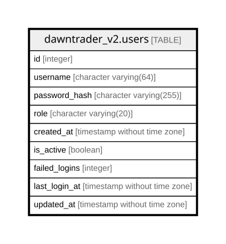

# dawntrader_v2.users

## Columns

| Name | Type | Default | Nullable | Children | Parents | Comment |
| ---- | ---- | ------- | -------- | -------- | ------- | ------- |
| id | integer | nextval('dawntrader_v2.users_id_seq'::regclass) | false |  |  |  |
| username | character varying(64) |  | false |  |  |  |
| password_hash | character varying(255) |  | false |  |  |  |
| role | character varying(20) | 'user'::character varying | true |  |  |  |
| created_at | timestamp without time zone | now() | true |  |  |  |
| is_active | boolean | true | false |  |  |  |
| failed_logins | integer | 0 | false |  |  |  |
| last_login_at | timestamp without time zone |  | true |  |  |  |
| updated_at | timestamp without time zone | now() | true |  |  |  |

## Viewpoints

| Name | Definition |
| ---- | ---------- |
| [dawntrader_v2 schema](viewpoint-schema-dawntrader_v2.md) | All mapped relations in dawntrader_v2. |

## Constraints

| Name | Type | Definition |
| ---- | ---- | ---------- |
| users_pkey | PRIMARY KEY | PRIMARY KEY (id) |
| users_username_key | UNIQUE | UNIQUE (username) |

## Indexes

| Name | Definition |
| ---- | ---------- |
| users_pkey | CREATE UNIQUE INDEX users_pkey ON dawntrader_v2.users USING btree (id) |
| users_username_key | CREATE UNIQUE INDEX users_username_key ON dawntrader_v2.users USING btree (username) |

## Relations

---

> Generated by [tbls](https://github.com/k1LoW/tbls)
