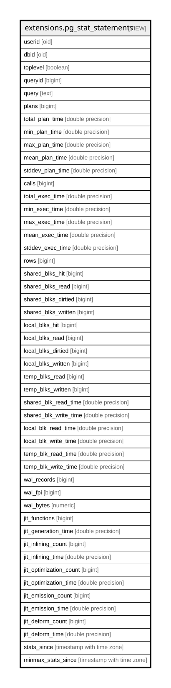

# extensions.pg_stat_statements

## Columns

| Name | Type | Default | Nullable | Children | Parents | Comment |
| ---- | ---- | ------- | -------- | -------- | ------- | ------- |
| userid | oid |  | true |  |  |  |
| dbid | oid |  | true |  |  |  |
| toplevel | boolean |  | true |  |  |  |
| queryid | bigint |  | true |  |  |  |
| query | text |  | true |  |  |  |
| plans | bigint |  | true |  |  |  |
| total_plan_time | double precision |  | true |  |  |  |
| min_plan_time | double precision |  | true |  |  |  |
| max_plan_time | double precision |  | true |  |  |  |
| mean_plan_time | double precision |  | true |  |  |  |
| stddev_plan_time | double precision |  | true |  |  |  |
| calls | bigint |  | true |  |  |  |
| total_exec_time | double precision |  | true |  |  |  |
| min_exec_time | double precision |  | true |  |  |  |
| max_exec_time | double precision |  | true |  |  |  |
| mean_exec_time | double precision |  | true |  |  |  |
| stddev_exec_time | double precision |  | true |  |  |  |
| rows | bigint |  | true |  |  |  |
| shared_blks_hit | bigint |  | true |  |  |  |
| shared_blks_read | bigint |  | true |  |  |  |
| shared_blks_dirtied | bigint |  | true |  |  |  |
| shared_blks_written | bigint |  | true |  |  |  |
| local_blks_hit | bigint |  | true |  |  |  |
| local_blks_read | bigint |  | true |  |  |  |
| local_blks_dirtied | bigint |  | true |  |  |  |
| local_blks_written | bigint |  | true |  |  |  |
| temp_blks_read | bigint |  | true |  |  |  |
| temp_blks_written | bigint |  | true |  |  |  |
| shared_blk_read_time | double precision |  | true |  |  |  |
| shared_blk_write_time | double precision |  | true |  |  |  |
| local_blk_read_time | double precision |  | true |  |  |  |
| local_blk_write_time | double precision |  | true |  |  |  |
| temp_blk_read_time | double precision |  | true |  |  |  |
| temp_blk_write_time | double precision |  | true |  |  |  |
| wal_records | bigint |  | true |  |  |  |
| wal_fpi | bigint |  | true |  |  |  |
| wal_bytes | numeric |  | true |  |  |  |
| jit_functions | bigint |  | true |  |  |  |
| jit_generation_time | double precision |  | true |  |  |  |
| jit_inlining_count | bigint |  | true |  |  |  |
| jit_inlining_time | double precision |  | true |  |  |  |
| jit_optimization_count | bigint |  | true |  |  |  |
| jit_optimization_time | double precision |  | true |  |  |  |
| jit_emission_count | bigint |  | true |  |  |  |
| jit_emission_time | double precision |  | true |  |  |  |
| jit_deform_count | bigint |  | true |  |  |  |
| jit_deform_time | double precision |  | true |  |  |  |
| stats_since | timestamp with time zone |  | true |  |  |  |
| minmax_stats_since | timestamp with time zone |  | true |  |  |  |

## Viewpoints

| Name | Definition |
| ---- | ---------- |
| [extensions schema](viewpoint-schema-extensions.md) | All mapped relations in extensions. |

## Relations

---

> Generated by [tbls](https://github.com/k1LoW/tbls)
