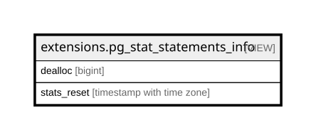

# extensions.pg_stat_statements_info

## Columns

| Name | Type | Default | Nullable | Children | Parents | Comment |
| ---- | ---- | ------- | -------- | -------- | ------- | ------- |
| dealloc | bigint |  | true |  |  |  |
| stats_reset | timestamp with time zone |  | true |  |  |  |

## Viewpoints

| Name | Definition |
| ---- | ---------- |
| [extensions schema](viewpoint-schema-extensions.md) | All mapped relations in extensions. |

## Relations

---

> Generated by [tbls](https://github.com/k1LoW/tbls)
