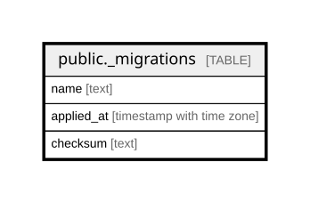

# public._migrations

## Columns

| Name | Type | Default | Nullable | Children | Parents | Comment |
| ---- | ---- | ------- | -------- | -------- | ------- | ------- |
| name | text |  | false |  |  |  |
| applied_at | timestamp with time zone | now() | false |  |  |  |
| checksum | text |  | true |  |  |  |

## Viewpoints

| Name | Definition |
| ---- | ---------- |
| [public schema](viewpoint-schema-public.md) | All mapped relations in public. |

## Constraints

| Name | Type | Definition |
| ---- | ---- | ---------- |
| _migrations_pkey | PRIMARY KEY | PRIMARY KEY (name) |

## Indexes

| Name | Definition |
| ---- | ---------- |
| _migrations_pkey | CREATE UNIQUE INDEX _migrations_pkey ON public._migrations USING btree (name) |

## Relations

---

> Generated by [tbls](https://github.com/k1LoW/tbls)
