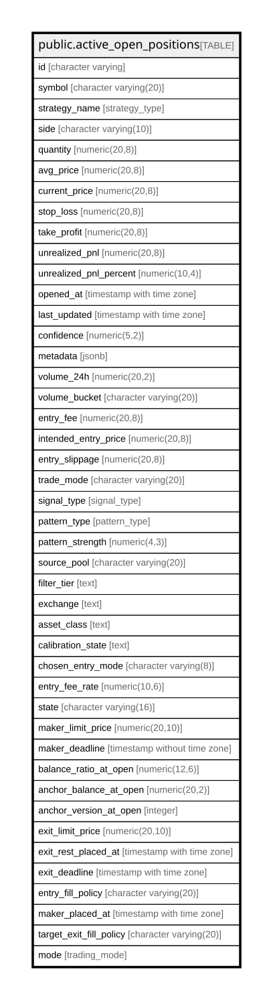

# public.active_open_positions

## Columns

| Name | Type | Default | Nullable | Children | Parents | Comment |
| ---- | ---- | ------- | -------- | -------- | ------- | ------- |
| id | character varying | gen_random_uuid() | false |  |  |  |
| symbol | character varying(20) |  | false |  |  |  |
| strategy_name | strategy_type |  | false |  |  |  |
| side | character varying(10) |  | false |  |  |  |
| quantity | numeric(20,8) |  | false |  |  |  |
| avg_price | numeric(20,8) |  | false |  |  |  |
| current_price | numeric(20,8) |  | true |  |  |  |
| stop_loss | numeric(20,8) |  | true |  |  |  |
| take_profit | numeric(20,8) |  | true |  |  |  |
| unrealized_pnl | numeric(20,8) |  | true |  |  |  |
| unrealized_pnl_percent | numeric(10,4) |  | true |  |  |  |
| opened_at | timestamp with time zone | now() | true |  |  |  |
| last_updated | timestamp with time zone | now() | true |  |  |  |
| confidence | numeric(5,2) |  | true |  |  |  |
| metadata | jsonb |  | true |  |  |  |
| volume_24h | numeric(20,2) |  | true |  |  |  |
| volume_bucket | character varying(20) |  | true |  |  |  |
| entry_fee | numeric(20,8) |  | true |  |  |  |
| intended_entry_price | numeric(20,8) |  | true |  |  |  |
| entry_slippage | numeric(20,8) |  | true |  |  |  |
| trade_mode | character varying(20) | 'TARGET'::character varying | true |  |  |  |
| signal_type | signal_type | 'QUANT'::signal_type | false |  |  |  |
| pattern_type | pattern_type |  | true |  |  |  |
| pattern_strength | numeric(4,3) |  | true |  |  |  |
| source_pool | character varying(20) |  | true |  |  |  |
| filter_tier | text |  | true |  |  |  |
| exchange | text | 'kraken'::text | false |  |  |  |
| asset_class | text |  | false |  |  |  |
| calibration_state | text | 'pre_calibration_xstock_2026_05'::text | false |  |  | P19-B4a C6 (2026-06-14): calibration-era marker for active-paper open positions. Same semantics + default as paper_sim_trades.calibration_state. |
| chosen_entry_mode | character varying(8) |  | true |  |  |  |
| entry_fee_rate | numeric(10,6) |  | true |  |  |  |
| state | character varying(16) | 'open'::character varying | true |  |  |  |
| maker_limit_price | numeric(20,10) |  | true |  |  |  |
| maker_deadline | timestamp without time zone |  | true |  |  |  |
| balance_ratio_at_open | numeric(12,6) |  | true |  |  |  |
| anchor_balance_at_open | numeric(20,2) |  | true |  |  |  |
| anchor_version_at_open | integer |  | true |  |  |  |
| exit_limit_price | numeric(20,10) |  | true |  |  |  |
| exit_rest_placed_at | timestamp with time zone |  | true |  |  |  |
| exit_deadline | timestamp with time zone |  | true |  |  |  |
| entry_fill_policy | character varying(20) |  | true |  |  |  |
| maker_placed_at | timestamp with time zone |  | true |  |  |  |
| target_exit_fill_policy | character varying(20) |  | true |  |  |  |
| mode | trading_mode |  | false |  |  |  |

## Viewpoints

| Name | Definition |
| ---- | ---------- |
| [public schema](viewpoint-schema-public.md) | All mapped relations in public. |

## Constraints

| Name | Type | Definition |
| ---- | ---- | ---------- |
| paper_sim_open_positions_pkey | PRIMARY KEY | PRIMARY KEY (id) |
| unique_symbol_mode | UNIQUE | UNIQUE (symbol, mode) |

## Indexes

| Name | Definition |
| ---- | ---------- |
| active_open_positions_strategy_idx | CREATE INDEX active_open_positions_strategy_idx ON public.active_open_positions USING btree (strategy_name) |
| paper_sim_open_positions_pkey | CREATE UNIQUE INDEX paper_sim_open_positions_pkey ON public.active_open_positions USING btree (id) |
| unique_symbol_mode | CREATE UNIQUE INDEX unique_symbol_mode ON public.active_open_positions USING btree (symbol, mode) |

## Relations

---

> Generated by [tbls](https://github.com/k1LoW/tbls)
