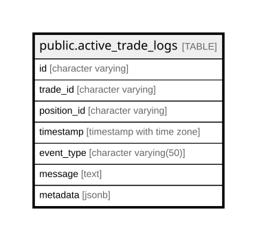

# public.active_trade_logs

## Columns

| Name | Type | Default | Nullable | Children | Parents | Comment |
| ---- | ---- | ------- | -------- | -------- | ------- | ------- |
| id | character varying | gen_random_uuid() | false |  |  |  |
| trade_id | character varying |  | true |  |  |  |
| position_id | character varying |  | true |  |  |  |
| timestamp | timestamp with time zone | now() | true |  |  |  |
| event_type | character varying(50) |  | false |  |  |  |
| message | text |  | false |  |  |  |
| metadata | jsonb |  | true |  |  |  |

## Viewpoints

| Name | Definition |
| ---- | ---------- |
| [public schema](viewpoint-schema-public.md) | All mapped relations in public. |

## Constraints

| Name | Type | Definition |
| ---- | ---- | ---------- |
| paper_sim_trade_logs_pkey | PRIMARY KEY | PRIMARY KEY (id) |

## Indexes

| Name | Definition |
| ---- | ---------- |
| active_trade_logs_event_type_idx | CREATE INDEX active_trade_logs_event_type_idx ON public.active_trade_logs USING btree (event_type) |
| active_trade_logs_trade_id_idx | CREATE INDEX active_trade_logs_trade_id_idx ON public.active_trade_logs USING btree (trade_id) |
| paper_sim_trade_logs_pkey | CREATE UNIQUE INDEX paper_sim_trade_logs_pkey ON public.active_trade_logs USING btree (id) |

## Relations

---

> Generated by [tbls](https://github.com/k1LoW/tbls)
