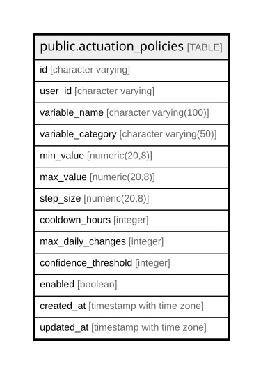

# public.actuation_policies

## Columns

| Name | Type | Default | Nullable | Children | Parents | Comment |
| ---- | ---- | ------- | -------- | -------- | ------- | ------- |
| id | character varying | gen_random_uuid() | false |  |  |  |
| user_id | character varying |  | false |  |  |  |
| variable_name | character varying(100) |  | false |  |  |  |
| variable_category | character varying(50) |  | false |  |  |  |
| min_value | numeric(20,8) |  | false |  |  |  |
| max_value | numeric(20,8) |  | false |  |  |  |
| step_size | numeric(20,8) |  | false |  |  |  |
| cooldown_hours | integer | 24 | true |  |  |  |
| max_daily_changes | integer | 3 | true |  |  |  |
| confidence_threshold | integer | 70 | true |  |  |  |
| enabled | boolean | true | true |  |  |  |
| created_at | timestamp with time zone | now() | true |  |  |  |
| updated_at | timestamp with time zone | now() | true |  |  |  |

## Viewpoints

| Name | Definition |
| ---- | ---------- |
| [public schema](viewpoint-schema-public.md) | All mapped relations in public. |

## Constraints

| Name | Type | Definition |
| ---- | ---- | ---------- |
| actuation_policies_pkey | PRIMARY KEY | PRIMARY KEY (id) |

## Indexes

| Name | Definition |
| ---- | ---------- |
| actuation_policies_pkey | CREATE UNIQUE INDEX actuation_policies_pkey ON public.actuation_policies USING btree (id) |
| actuation_policies_user_variable_idx | CREATE UNIQUE INDEX actuation_policies_user_variable_idx ON public.actuation_policies USING btree (user_id, variable_name) |

## Relations

---

> Generated by [tbls](https://github.com/k1LoW/tbls)
