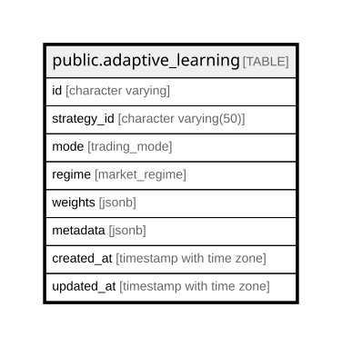

# public.adaptive_learning

## Description

Directive 11.1B: Adaptive learning weight persistence with timestamp propagation

## Columns

| Name | Type | Default | Nullable | Children | Parents | Comment |
| ---- | ---- | ------- | -------- | -------- | ------- | ------- |
| id | character varying | gen_random_uuid() | false |  |  |  |
| strategy_id | character varying(50) |  | false |  |  | Unique identifier for the strategy |
| mode | trading_mode |  | false |  |  |  |
| regime | market_regime |  | false |  |  |  |
| weights | jsonb |  | false |  |  | AdaptiveWeights JSON object |
| metadata | jsonb |  | true |  |  |  |
| created_at | timestamp with time zone | now() | false |  |  |  |
| updated_at | timestamp with time zone | now() | false |  |  | Timestamp for time-based decay calculation |

## Viewpoints

| Name | Definition |
| ---- | ---------- |
| [public schema](viewpoint-schema-public.md) | All mapped relations in public. |

## Constraints

| Name | Type | Definition |
| ---- | ---- | ---------- |
| adaptive_learning_pkey | PRIMARY KEY | PRIMARY KEY (id) |

## Indexes

| Name | Definition |
| ---- | ---------- |
| adaptive_learning_pkey | CREATE UNIQUE INDEX adaptive_learning_pkey ON public.adaptive_learning USING btree (id) |
| adaptive_learning_regime_idx | CREATE INDEX adaptive_learning_regime_idx ON public.adaptive_learning USING btree (regime) |
| adaptive_learning_strategy_mode_idx | CREATE INDEX adaptive_learning_strategy_mode_idx ON public.adaptive_learning USING btree (strategy_id, mode) |
| adaptive_learning_updated_at_idx | CREATE INDEX adaptive_learning_updated_at_idx ON public.adaptive_learning USING btree (updated_at) |

## Relations

---

> Generated by [tbls](https://github.com/k1LoW/tbls)
