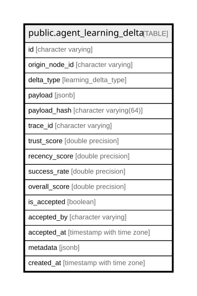

# public.agent_learning_delta

## Columns

| Name | Type | Default | Nullable | Children | Parents | Comment |
| ---- | ---- | ------- | -------- | -------- | ------- | ------- |
| id | character varying | gen_random_uuid() | false |  |  |  |
| origin_node_id | character varying |  | false |  |  |  |
| delta_type | learning_delta_type |  | false |  |  |  |
| payload | jsonb |  | false |  |  |  |
| payload_hash | character varying(64) |  | false |  |  |  |
| trace_id | character varying |  | false |  |  |  |
| trust_score | double precision | 0.5 | false |  |  |  |
| recency_score | double precision | 1.0 | false |  |  |  |
| success_rate | double precision | 0.0 | false |  |  |  |
| overall_score | double precision | 0.0 | false |  |  |  |
| is_accepted | boolean | false | false |  |  |  |
| accepted_by | character varying |  | true |  |  |  |
| accepted_at | timestamp with time zone |  | true |  |  |  |
| metadata | jsonb |  | true |  |  |  |
| created_at | timestamp with time zone | now() | false |  |  |  |

## Viewpoints

| Name | Definition |
| ---- | ---------- |
| [public schema](viewpoint-schema-public.md) | All mapped relations in public. |

## Constraints

| Name | Type | Definition |
| ---- | ---- | ---------- |
| agent_learning_delta_pkey | PRIMARY KEY | PRIMARY KEY (id) |

## Indexes

| Name | Definition |
| ---- | ---------- |
| agent_learning_delta_created_at_idx | CREATE INDEX agent_learning_delta_created_at_idx ON public.agent_learning_delta USING btree (created_at) |
| agent_learning_delta_delta_type_idx | CREATE INDEX agent_learning_delta_delta_type_idx ON public.agent_learning_delta USING btree (delta_type) |
| agent_learning_delta_is_accepted_idx | CREATE INDEX agent_learning_delta_is_accepted_idx ON public.agent_learning_delta USING btree (is_accepted) |
| agent_learning_delta_origin_node_id_idx | CREATE INDEX agent_learning_delta_origin_node_id_idx ON public.agent_learning_delta USING btree (origin_node_id) |
| agent_learning_delta_pkey | CREATE UNIQUE INDEX agent_learning_delta_pkey ON public.agent_learning_delta USING btree (id) |
| agent_learning_delta_trace_id_idx | CREATE INDEX agent_learning_delta_trace_id_idx ON public.agent_learning_delta USING btree (trace_id) |

## Relations

---

> Generated by [tbls](https://github.com/k1LoW/tbls)
