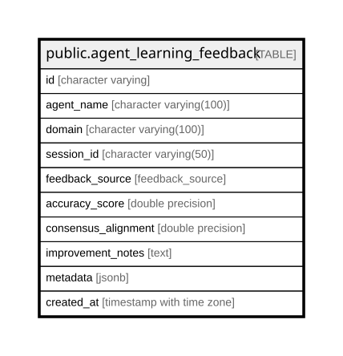

# public.agent_learning_feedback

## Columns

| Name | Type | Default | Nullable | Children | Parents | Comment |
| ---- | ---- | ------- | -------- | -------- | ------- | ------- |
| id | character varying | gen_random_uuid() | false |  |  |  |
| agent_name | character varying(100) |  | false |  |  |  |
| domain | character varying(100) |  | false |  |  |  |
| session_id | character varying(50) |  | true |  |  |  |
| feedback_source | feedback_source |  | false |  |  |  |
| accuracy_score | double precision |  | true |  |  |  |
| consensus_alignment | double precision |  | true |  |  |  |
| improvement_notes | text |  | true |  |  |  |
| metadata | jsonb |  | true |  |  |  |
| created_at | timestamp with time zone | now() | false |  |  |  |

## Viewpoints

| Name | Definition |
| ---- | ---------- |
| [public schema](viewpoint-schema-public.md) | All mapped relations in public. |

## Constraints

| Name | Type | Definition |
| ---- | ---- | ---------- |
| agent_learning_feedback_pkey | PRIMARY KEY | PRIMARY KEY (id) |

## Indexes

| Name | Definition |
| ---- | ---------- |
| agent_learning_feedback_agent_name_idx | CREATE INDEX agent_learning_feedback_agent_name_idx ON public.agent_learning_feedback USING btree (agent_name) |
| agent_learning_feedback_created_at_idx | CREATE INDEX agent_learning_feedback_created_at_idx ON public.agent_learning_feedback USING btree (created_at) |
| agent_learning_feedback_domain_idx | CREATE INDEX agent_learning_feedback_domain_idx ON public.agent_learning_feedback USING btree (domain) |
| agent_learning_feedback_pkey | CREATE UNIQUE INDEX agent_learning_feedback_pkey ON public.agent_learning_feedback USING btree (id) |
| agent_learning_feedback_session_id_idx | CREATE INDEX agent_learning_feedback_session_id_idx ON public.agent_learning_feedback USING btree (session_id) |

## Relations

---

> Generated by [tbls](https://github.com/k1LoW/tbls)
