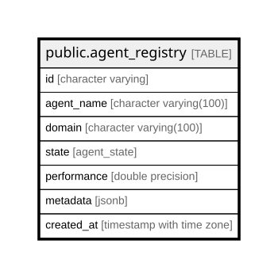

# public.agent_registry

## Columns

| Name | Type | Default | Nullable | Children | Parents | Comment |
| ---- | ---- | ------- | -------- | -------- | ------- | ------- |
| id | character varying | gen_random_uuid() | false |  |  |  |
| agent_name | character varying(100) |  | false |  |  |  |
| domain | character varying(100) |  | false |  |  |  |
| state | agent_state | 'active'::agent_state | false |  |  |  |
| performance | double precision | 0.5 | false |  |  |  |
| metadata | jsonb |  | true |  |  |  |
| created_at | timestamp with time zone | now() | false |  |  |  |

## Viewpoints

| Name | Definition |
| ---- | ---------- |
| [public schema](viewpoint-schema-public.md) | All mapped relations in public. |

## Constraints

| Name | Type | Definition |
| ---- | ---- | ---------- |
| agent_registry_pkey | PRIMARY KEY | PRIMARY KEY (id) |

## Indexes

| Name | Definition |
| ---- | ---------- |
| agent_registry_agent_name_idx | CREATE INDEX agent_registry_agent_name_idx ON public.agent_registry USING btree (agent_name) |
| agent_registry_created_at_idx | CREATE INDEX agent_registry_created_at_idx ON public.agent_registry USING btree (created_at) |
| agent_registry_domain_idx | CREATE INDEX agent_registry_domain_idx ON public.agent_registry USING btree (domain) |
| agent_registry_pkey | CREATE UNIQUE INDEX agent_registry_pkey ON public.agent_registry USING btree (id) |
| agent_registry_state_idx | CREATE INDEX agent_registry_state_idx ON public.agent_registry USING btree (state) |

## Relations

---

> Generated by [tbls](https://github.com/k1LoW/tbls)
