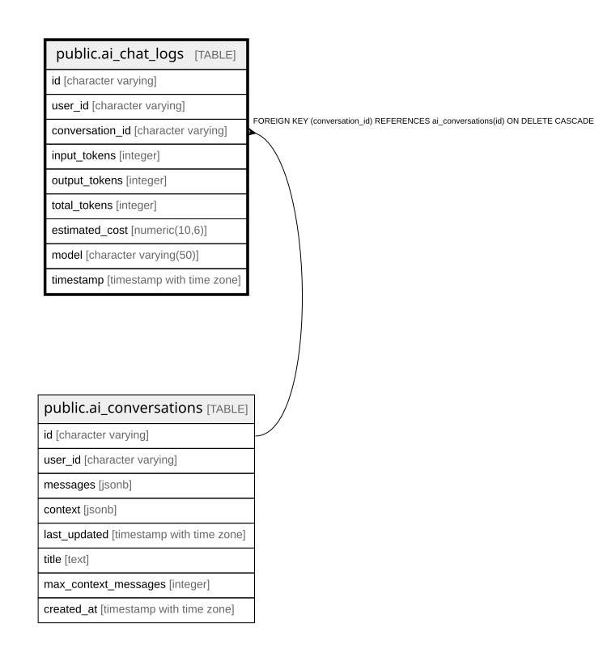

# public.ai_chat_logs

## Columns

| Name | Type | Default | Nullable | Children | Parents | Comment |
| ---- | ---- | ------- | -------- | -------- | ------- | ------- |
| id | character varying | gen_random_uuid() | false |  |  |  |
| user_id | character varying |  | false |  |  |  |
| conversation_id | character varying |  | true |  | [public.ai_conversations](public.ai_conversations.md) |  |
| input_tokens | integer |  | false |  |  |  |
| output_tokens | integer |  | false |  |  |  |
| total_tokens | integer |  | false |  |  |  |
| estimated_cost | numeric(10,6) |  | false |  |  |  |
| model | character varying(50) | 'gpt-4o'::character varying | true |  |  |  |
| timestamp | timestamp with time zone | now() | true |  |  |  |

## Viewpoints

| Name | Definition |
| ---- | ---------- |
| [public schema](viewpoint-schema-public.md) | All mapped relations in public. |

## Constraints

| Name | Type | Definition |
| ---- | ---- | ---------- |
| ai_chat_logs_conversation_id_ai_conversations_id_fk | FOREIGN KEY | FOREIGN KEY (conversation_id) REFERENCES ai_conversations(id) ON DELETE CASCADE |
| ai_chat_logs_pkey | PRIMARY KEY | PRIMARY KEY (id) |

## Indexes

| Name | Definition |
| ---- | ---------- |
| ai_chat_logs_pkey | CREATE UNIQUE INDEX ai_chat_logs_pkey ON public.ai_chat_logs USING btree (id) |

## Relations

---

> Generated by [tbls](https://github.com/k1LoW/tbls)
