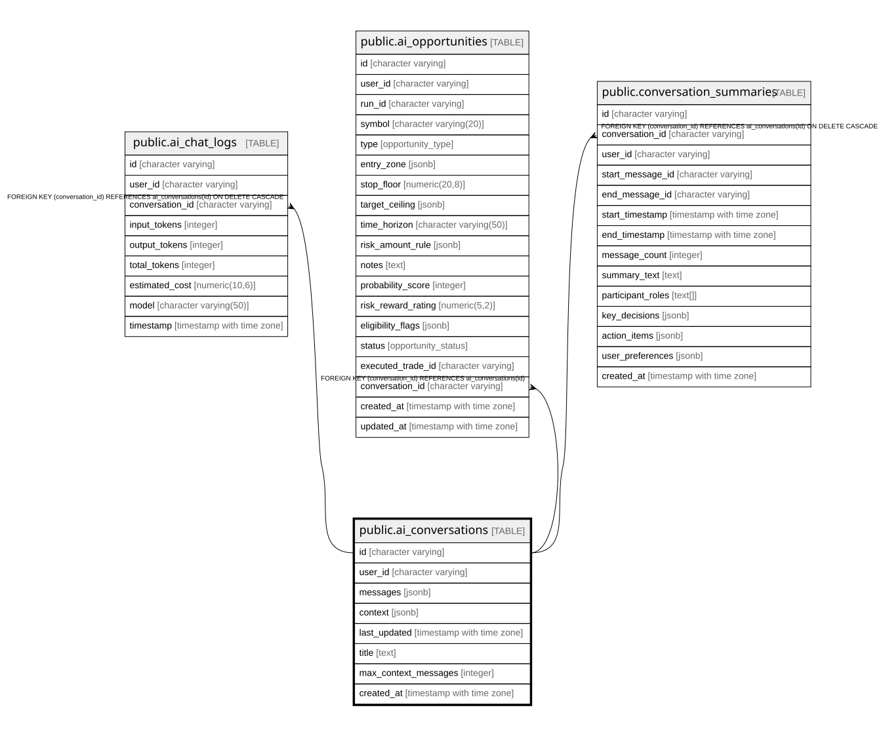

# public.ai_conversations

## Columns

| Name | Type | Default | Nullable | Children | Parents | Comment |
| ---- | ---- | ------- | -------- | -------- | ------- | ------- |
| id | character varying | gen_random_uuid() | false | [public.ai_chat_logs](public.ai_chat_logs.md) [public.ai_opportunities](public.ai_opportunities.md) [public.conversation_summaries](public.conversation_summaries.md) |  |  |
| user_id | character varying |  | false |  |  |  |
| messages | jsonb |  | false |  |  |  |
| context | jsonb |  | true |  |  |  |
| last_updated | timestamp with time zone | now() | true |  |  |  |
| title | text | 'New Chat'::text | true |  |  |  |
| max_context_messages | integer | 20 | true |  |  |  |
| created_at | timestamp with time zone | now() | true |  |  |  |

## Viewpoints

| Name | Definition |
| ---- | ---------- |
| [public schema](viewpoint-schema-public.md) | All mapped relations in public. |

## Constraints

| Name | Type | Definition |
| ---- | ---- | ---------- |
| ai_conversations_pkey | PRIMARY KEY | PRIMARY KEY (id) |

## Indexes

| Name | Definition |
| ---- | ---------- |
| ai_conversations_pkey | CREATE UNIQUE INDEX ai_conversations_pkey ON public.ai_conversations USING btree (id) |

## Relations

---

> Generated by [tbls](https://github.com/k1LoW/tbls)
