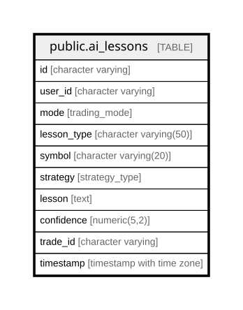

# public.ai_lessons

## Columns

| Name | Type | Default | Nullable | Children | Parents | Comment |
| ---- | ---- | ------- | -------- | -------- | ------- | ------- |
| id | character varying | gen_random_uuid() | false |  |  |  |
| user_id | character varying |  | false |  |  |  |
| mode | trading_mode |  | false |  |  |  |
| lesson_type | character varying(50) |  | false |  |  |  |
| symbol | character varying(20) |  | true |  |  |  |
| strategy | strategy_type |  | true |  |  |  |
| lesson | text |  | false |  |  |  |
| confidence | numeric(5,2) |  | true |  |  |  |
| trade_id | character varying |  | true |  |  |  |
| timestamp | timestamp with time zone | now() | true |  |  |  |

## Viewpoints

| Name | Definition |
| ---- | ---------- |
| [public schema](viewpoint-schema-public.md) | All mapped relations in public. |

## Constraints

| Name | Type | Definition |
| ---- | ---- | ---------- |
| ai_lessons_pkey | PRIMARY KEY | PRIMARY KEY (id) |

## Indexes

| Name | Definition |
| ---- | ---------- |
| ai_lessons_pkey | CREATE UNIQUE INDEX ai_lessons_pkey ON public.ai_lessons USING btree (id) |
| ai_lessons_user_mode_timestamp_idx | CREATE UNIQUE INDEX ai_lessons_user_mode_timestamp_idx ON public.ai_lessons USING btree (user_id, mode, "timestamp") |

## Relations

---

> Generated by [tbls](https://github.com/k1LoW/tbls)
