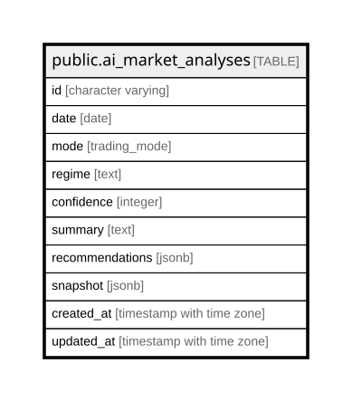

# public.ai_market_analyses

## Columns

| Name | Type | Default | Nullable | Children | Parents | Comment |
| ---- | ---- | ------- | -------- | -------- | ------- | ------- |
| id | character varying | gen_random_uuid() | false |  |  |  |
| date | date |  | false |  |  |  |
| mode | trading_mode |  | false |  |  |  |
| regime | text |  | false |  |  |  |
| confidence | integer |  | true |  |  |  |
| summary | text |  | true |  |  |  |
| recommendations | jsonb |  | true |  |  |  |
| snapshot | jsonb |  | true |  |  |  |
| created_at | timestamp with time zone | now() | true |  |  |  |
| updated_at | timestamp with time zone | now() | true |  |  |  |

## Viewpoints

| Name | Definition |
| ---- | ---------- |
| [public schema](viewpoint-schema-public.md) | All mapped relations in public. |

## Constraints

| Name | Type | Definition |
| ---- | ---- | ---------- |
| ai_market_analyses_pkey | PRIMARY KEY | PRIMARY KEY (id) |

## Indexes

| Name | Definition |
| ---- | ---------- |
| ai_market_analyses_date_mode_idx | CREATE UNIQUE INDEX ai_market_analyses_date_mode_idx ON public.ai_market_analyses USING btree (date, mode) |
| ai_market_analyses_pkey | CREATE UNIQUE INDEX ai_market_analyses_pkey ON public.ai_market_analyses USING btree (id) |

## Relations

---

> Generated by [tbls](https://github.com/k1LoW/tbls)
