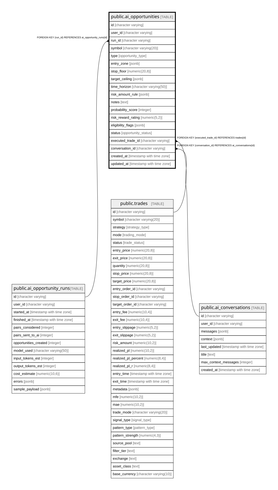

# public.ai_opportunities

## Columns

| Name | Type | Default | Nullable | Children | Parents | Comment |
| ---- | ---- | ------- | -------- | -------- | ------- | ------- |
| id | character varying | gen_random_uuid() | false |  |  |  |
| user_id | character varying |  | false |  |  |  |
| run_id | character varying |  | true |  | [public.ai_opportunity_runs](public.ai_opportunity_runs.md) |  |
| symbol | character varying(20) |  | false |  |  |  |
| type | opportunity_type |  | false |  |  |  |
| entry_zone | jsonb |  | false |  |  |  |
| stop_floor | numeric(20,8) |  | false |  |  |  |
| target_ceiling | jsonb |  | false |  |  |  |
| time_horizon | character varying(50) |  | true |  |  |  |
| risk_amount_rule | jsonb |  | true |  |  |  |
| notes | text |  | true |  |  |  |
| probability_score | integer |  | true |  |  |  |
| risk_reward_rating | numeric(5,2) |  | true |  |  |  |
| eligibility_flags | jsonb |  | true |  |  |  |
| status | opportunity_status | 'new'::opportunity_status | true |  |  |  |
| executed_trade_id | character varying |  | true |  | [public.trades](public.trades.md) |  |
| conversation_id | character varying |  | true |  | [public.ai_conversations](public.ai_conversations.md) |  |
| created_at | timestamp with time zone | now() | true |  |  |  |
| updated_at | timestamp with time zone | now() | true |  |  |  |

## Viewpoints

| Name | Definition |
| ---- | ---------- |
| [public schema](viewpoint-schema-public.md) | All mapped relations in public. |

## Constraints

| Name | Type | Definition |
| ---- | ---- | ---------- |
| ai_opportunities_conversation_id_ai_conversations_id_fk | FOREIGN KEY | FOREIGN KEY (conversation_id) REFERENCES ai_conversations(id) |
| ai_opportunities_executed_trade_id_trades_id_fk | FOREIGN KEY | FOREIGN KEY (executed_trade_id) REFERENCES trades(id) |
| ai_opportunities_pkey | PRIMARY KEY | PRIMARY KEY (id) |
| ai_opportunities_run_id_ai_opportunity_runs_id_fk | FOREIGN KEY | FOREIGN KEY (run_id) REFERENCES ai_opportunity_runs(id) |

## Indexes

| Name | Definition |
| ---- | ---------- |
| ai_opportunities_pkey | CREATE UNIQUE INDEX ai_opportunities_pkey ON public.ai_opportunities USING btree (id) |

## Relations

---

> Generated by [tbls](https://github.com/k1LoW/tbls)
