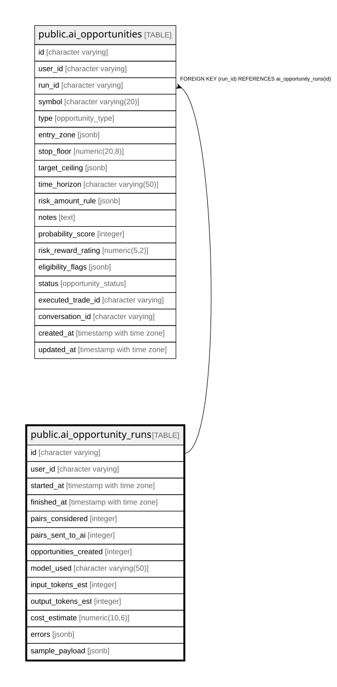

# public.ai_opportunity_runs

## Columns

| Name | Type | Default | Nullable | Children | Parents | Comment |
| ---- | ---- | ------- | -------- | -------- | ------- | ------- |
| id | character varying | gen_random_uuid() | false | [public.ai_opportunities](public.ai_opportunities.md) |  |  |
| user_id | character varying |  | false |  |  |  |
| started_at | timestamp with time zone | now() | true |  |  |  |
| finished_at | timestamp with time zone |  | true |  |  |  |
| pairs_considered | integer | 0 | true |  |  |  |
| pairs_sent_to_ai | integer | 0 | true |  |  |  |
| opportunities_created | integer | 0 | true |  |  |  |
| model_used | character varying(50) | 'gpt-4o-mini'::character varying | true |  |  |  |
| input_tokens_est | integer | 0 | true |  |  |  |
| output_tokens_est | integer | 0 | true |  |  |  |
| cost_estimate | numeric(10,6) | '0'::numeric | true |  |  |  |
| errors | jsonb |  | true |  |  |  |
| sample_payload | jsonb |  | true |  |  |  |

## Viewpoints

| Name | Definition |
| ---- | ---------- |
| [public schema](viewpoint-schema-public.md) | All mapped relations in public. |

## Constraints

| Name | Type | Definition |
| ---- | ---- | ---------- |
| ai_opportunity_runs_pkey | PRIMARY KEY | PRIMARY KEY (id) |

## Indexes

| Name | Definition |
| ---- | ---------- |
| ai_opportunity_runs_pkey | CREATE UNIQUE INDEX ai_opportunity_runs_pkey ON public.ai_opportunity_runs USING btree (id) |

## Relations

---

> Generated by [tbls](https://github.com/k1LoW/tbls)
