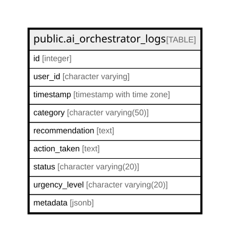

# public.ai_orchestrator_logs

## Columns

| Name | Type | Default | Nullable | Children | Parents | Comment |
| ---- | ---- | ------- | -------- | -------- | ------- | ------- |
| id | integer | nextval('ai_orchestrator_logs_id_seq'::regclass) | false |  |  |  |
| user_id | character varying |  | false |  |  |  |
| timestamp | timestamp with time zone | now() | true |  |  |  |
| category | character varying(50) |  | false |  |  |  |
| recommendation | text |  | false |  |  |  |
| action_taken | text |  | true |  |  |  |
| status | character varying(20) | 'pending'::character varying | false |  |  |  |
| urgency_level | character varying(20) | 'low'::character varying | true |  |  |  |
| metadata | jsonb |  | true |  |  |  |

## Viewpoints

| Name | Definition |
| ---- | ---------- |
| [public schema](viewpoint-schema-public.md) | All mapped relations in public. |

## Constraints

| Name | Type | Definition |
| ---- | ---- | ---------- |
| ai_orchestrator_logs_pkey | PRIMARY KEY | PRIMARY KEY (id) |

## Indexes

| Name | Definition |
| ---- | ---------- |
| ai_orchestrator_logs_pkey | CREATE UNIQUE INDEX ai_orchestrator_logs_pkey ON public.ai_orchestrator_logs USING btree (id) |

## Relations

---

> Generated by [tbls](https://github.com/k1LoW/tbls)
