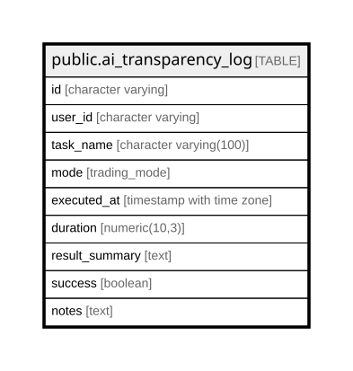

# public.ai_transparency_log

## Columns

| Name | Type | Default | Nullable | Children | Parents | Comment |
| ---- | ---- | ------- | -------- | -------- | ------- | ------- |
| id | character varying | gen_random_uuid() | false |  |  |  |
| user_id | character varying |  | true |  |  |  |
| task_name | character varying(100) |  | false |  |  |  |
| mode | trading_mode |  | true |  |  |  |
| executed_at | timestamp with time zone | now() | true |  |  |  |
| duration | numeric(10,3) |  | true |  |  |  |
| result_summary | text |  | true |  |  |  |
| success | boolean |  | false |  |  |  |
| notes | text |  | true |  |  |  |

## Viewpoints

| Name | Definition |
| ---- | ---------- |
| [public schema](viewpoint-schema-public.md) | All mapped relations in public. |

## Constraints

| Name | Type | Definition |
| ---- | ---- | ---------- |
| ai_transparency_log_pkey | PRIMARY KEY | PRIMARY KEY (id) |

## Indexes

| Name | Definition |
| ---- | ---------- |
| ai_transparency_log_pkey | CREATE UNIQUE INDEX ai_transparency_log_pkey ON public.ai_transparency_log USING btree (id) |
| ai_transparency_log_task_executed_idx | CREATE UNIQUE INDEX ai_transparency_log_task_executed_idx ON public.ai_transparency_log USING btree (task_name, executed_at) |

## Relations

---

> Generated by [tbls](https://github.com/k1LoW/tbls)
