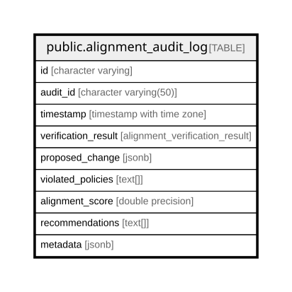

# public.alignment_audit_log

## Columns

| Name | Type | Default | Nullable | Children | Parents | Comment |
| ---- | ---- | ------- | -------- | -------- | ------- | ------- |
| id | character varying | gen_random_uuid() | false |  |  |  |
| audit_id | character varying(50) |  | false |  |  |  |
| timestamp | timestamp with time zone | now() | false |  |  |  |
| verification_result | alignment_verification_result |  | false |  |  |  |
| proposed_change | jsonb |  | false |  |  |  |
| violated_policies | text[] | ARRAY[]::text[] | true |  |  |  |
| alignment_score | double precision |  | true |  |  |  |
| recommendations | text[] | ARRAY[]::text[] | true |  |  |  |
| metadata | jsonb |  | true |  |  |  |

## Viewpoints

| Name | Definition |
| ---- | ---------- |
| [public schema](viewpoint-schema-public.md) | All mapped relations in public. |

## Constraints

| Name | Type | Definition |
| ---- | ---- | ---------- |
| alignment_audit_log_audit_id_unique | UNIQUE | UNIQUE (audit_id) |
| alignment_audit_log_pkey | PRIMARY KEY | PRIMARY KEY (id) |

## Indexes

| Name | Definition |
| ---- | ---------- |
| alignment_audit_log_audit_id_idx | CREATE INDEX alignment_audit_log_audit_id_idx ON public.alignment_audit_log USING btree (audit_id) |
| alignment_audit_log_audit_id_unique | CREATE UNIQUE INDEX alignment_audit_log_audit_id_unique ON public.alignment_audit_log USING btree (audit_id) |
| alignment_audit_log_pkey | CREATE UNIQUE INDEX alignment_audit_log_pkey ON public.alignment_audit_log USING btree (id) |
| alignment_audit_log_timestamp_idx | CREATE INDEX alignment_audit_log_timestamp_idx ON public.alignment_audit_log USING btree ("timestamp") |
| alignment_audit_log_verification_result_idx | CREATE INDEX alignment_audit_log_verification_result_idx ON public.alignment_audit_log USING btree (verification_result) |

## Relations

---

> Generated by [tbls](https://github.com/k1LoW/tbls)
