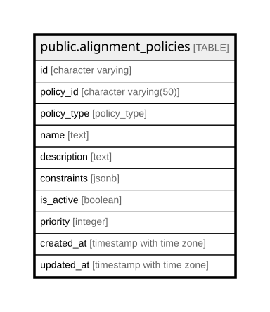

# public.alignment_policies

## Columns

| Name | Type | Default | Nullable | Children | Parents | Comment |
| ---- | ---- | ------- | -------- | -------- | ------- | ------- |
| id | character varying | gen_random_uuid() | false |  |  |  |
| policy_id | character varying(50) |  | false |  |  |  |
| policy_type | policy_type |  | false |  |  |  |
| name | text |  | false |  |  |  |
| description | text |  | false |  |  |  |
| constraints | jsonb |  | false |  |  |  |
| is_active | boolean | true | false |  |  |  |
| priority | integer | 0 | false |  |  |  |
| created_at | timestamp with time zone | now() | false |  |  |  |
| updated_at | timestamp with time zone | now() | false |  |  |  |

## Viewpoints

| Name | Definition |
| ---- | ---------- |
| [public schema](viewpoint-schema-public.md) | All mapped relations in public. |

## Constraints

| Name | Type | Definition |
| ---- | ---- | ---------- |
| alignment_policies_pkey | PRIMARY KEY | PRIMARY KEY (id) |
| alignment_policies_policy_id_unique | UNIQUE | UNIQUE (policy_id) |

## Indexes

| Name | Definition |
| ---- | ---------- |
| alignment_policies_is_active_idx | CREATE INDEX alignment_policies_is_active_idx ON public.alignment_policies USING btree (is_active) |
| alignment_policies_pkey | CREATE UNIQUE INDEX alignment_policies_pkey ON public.alignment_policies USING btree (id) |
| alignment_policies_policy_id_idx | CREATE INDEX alignment_policies_policy_id_idx ON public.alignment_policies USING btree (policy_id) |
| alignment_policies_policy_id_unique | CREATE UNIQUE INDEX alignment_policies_policy_id_unique ON public.alignment_policies USING btree (policy_id) |
| alignment_policies_policy_type_idx | CREATE INDEX alignment_policies_policy_type_idx ON public.alignment_policies USING btree (policy_type) |

## Relations

---

> Generated by [tbls](https://github.com/k1LoW/tbls)
