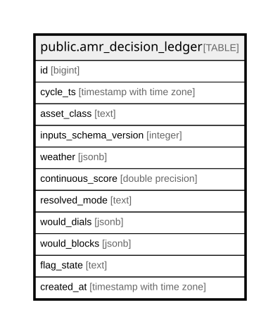

# public.amr_decision_ledger

## Columns

| Name | Type | Default | Nullable | Children | Parents | Comment |
| ---- | ---- | ------- | -------- | -------- | ------- | ------- |
| id | bigint | nextval('amr_decision_ledger_id_seq'::regclass) | false |  |  |  |
| cycle_ts | timestamp with time zone |  | false |  |  |  |
| asset_class | text |  | false |  |  |  |
| inputs_schema_version | integer |  | false |  |  |  |
| weather | jsonb |  | false |  |  |  |
| continuous_score | double precision |  | true |  |  |  |
| resolved_mode | text |  | true |  |  |  |
| would_dials | jsonb |  | true |  |  |  |
| would_blocks | jsonb |  | true |  |  |  |
| flag_state | text |  | false |  |  |  |
| created_at | timestamp with time zone | now() | false |  |  |  |

## Viewpoints

| Name | Definition |
| ---- | ---------- |
| [public schema](viewpoint-schema-public.md) | All mapped relations in public. |

## Constraints

| Name | Type | Definition |
| ---- | ---- | ---------- |
| amr_decision_ledger_pkey | PRIMARY KEY | PRIMARY KEY (id) |

## Indexes

| Name | Definition |
| ---- | ---------- |
| amr_decision_ledger_class_ts_idx | CREATE INDEX amr_decision_ledger_class_ts_idx ON public.amr_decision_ledger USING btree (asset_class, cycle_ts) |
| amr_decision_ledger_pkey | CREATE UNIQUE INDEX amr_decision_ledger_pkey ON public.amr_decision_ledger USING btree (id) |

## Relations

---

> Generated by [tbls](https://github.com/k1LoW/tbls)
