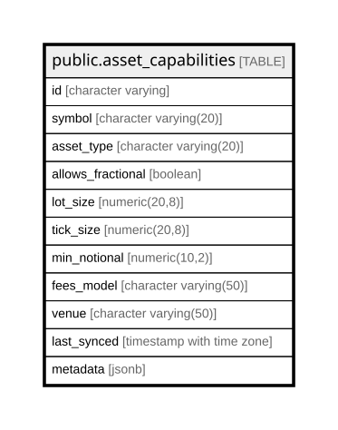

# public.asset_capabilities

## Columns

| Name | Type | Default | Nullable | Children | Parents | Comment |
| ---- | ---- | ------- | -------- | -------- | ------- | ------- |
| id | character varying | gen_random_uuid() | false |  |  |  |
| symbol | character varying(20) |  | false |  |  |  |
| asset_type | character varying(20) |  | false |  |  |  |
| allows_fractional | boolean | true | false |  |  |  |
| lot_size | numeric(20,8) |  | false |  |  |  |
| tick_size | numeric(20,8) |  | false |  |  |  |
| min_notional | numeric(10,2) |  | false |  |  |  |
| fees_model | character varying(50) | 'maker_taker'::character varying | true |  |  |  |
| venue | character varying(50) |  | false |  |  |  |
| last_synced | timestamp with time zone | now() | true |  |  |  |
| metadata | jsonb |  | true |  |  |  |

## Viewpoints

| Name | Definition |
| ---- | ---------- |
| [public schema](viewpoint-schema-public.md) | All mapped relations in public. |

## Constraints

| Name | Type | Definition |
| ---- | ---- | ---------- |
| asset_capabilities_pkey | PRIMARY KEY | PRIMARY KEY (id) |
| asset_capabilities_symbol_unique | UNIQUE | UNIQUE (symbol) |

## Indexes

| Name | Definition |
| ---- | ---------- |
| asset_capabilities_pkey | CREATE UNIQUE INDEX asset_capabilities_pkey ON public.asset_capabilities USING btree (id) |
| asset_capabilities_symbol_idx | CREATE UNIQUE INDEX asset_capabilities_symbol_idx ON public.asset_capabilities USING btree (symbol) |
| asset_capabilities_symbol_unique | CREATE UNIQUE INDEX asset_capabilities_symbol_unique ON public.asset_capabilities USING btree (symbol) |

## Relations

---

> Generated by [tbls](https://github.com/k1LoW/tbls)
