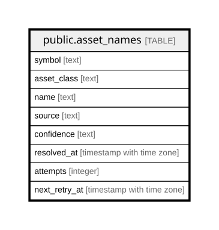

# public.asset_names

## Columns

| Name | Type | Default | Nullable | Children | Parents | Comment |
| ---- | ---- | ------- | -------- | -------- | ------- | ------- |
| symbol | text |  | false |  |  |  |
| asset_class | text |  | false |  |  |  |
| name | text |  | true |  |  |  |
| source | text |  | false |  |  |  |
| confidence | text | 'resolved'::text | false |  |  |  |
| resolved_at | timestamp with time zone | now() | false |  |  |  |
| attempts | integer | 1 | false |  |  |  |
| next_retry_at | timestamp with time zone |  | true |  |  |  |

## Viewpoints

| Name | Definition |
| ---- | ---------- |
| [public schema](viewpoint-schema-public.md) | All mapped relations in public. |

## Constraints

| Name | Type | Definition |
| ---- | ---- | ---------- |
| asset_names_pkey | PRIMARY KEY | PRIMARY KEY (symbol, asset_class) |

## Indexes

| Name | Definition |
| ---- | ---------- |
| asset_names_pkey | CREATE UNIQUE INDEX asset_names_pkey ON public.asset_names USING btree (symbol, asset_class) |
| idx_asset_names_class_resolved | CREATE INDEX idx_asset_names_class_resolved ON public.asset_names USING btree (asset_class) WHERE (name IS NOT NULL) |

## Relations

---

> Generated by [tbls](https://github.com/k1LoW/tbls)
