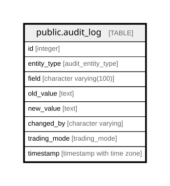

# public.audit_log

## Columns

| Name | Type | Default | Nullable | Children | Parents | Comment |
| ---- | ---- | ------- | -------- | -------- | ------- | ------- |
| id | integer | nextval('audit_log_id_seq'::regclass) | false |  |  |  |
| entity_type | audit_entity_type |  | false |  |  |  |
| field | character varying(100) |  | false |  |  |  |
| old_value | text |  | true |  |  |  |
| new_value | text |  | true |  |  |  |
| changed_by | character varying |  | false |  |  |  |
| trading_mode | trading_mode |  | false |  |  |  |
| timestamp | timestamp with time zone | now() | false |  |  |  |

## Viewpoints

| Name | Definition |
| ---- | ---------- |
| [public schema](viewpoint-schema-public.md) | All mapped relations in public. |

## Constraints

| Name | Type | Definition |
| ---- | ---- | ---------- |
| audit_log_pkey | PRIMARY KEY | PRIMARY KEY (id) |

## Indexes

| Name | Definition |
| ---- | ---------- |
| audit_log_changed_by_idx | CREATE INDEX audit_log_changed_by_idx ON public.audit_log USING btree (changed_by) |
| audit_log_entity_type_idx | CREATE INDEX audit_log_entity_type_idx ON public.audit_log USING btree (entity_type) |
| audit_log_pkey | CREATE UNIQUE INDEX audit_log_pkey ON public.audit_log USING btree (id) |
| audit_log_timestamp_idx | CREATE INDEX audit_log_timestamp_idx ON public.audit_log USING btree ("timestamp") |
| audit_log_trading_mode_idx | CREATE INDEX audit_log_trading_mode_idx ON public.audit_log USING btree (trading_mode) |

## Relations

---

> Generated by [tbls](https://github.com/k1LoW/tbls)
