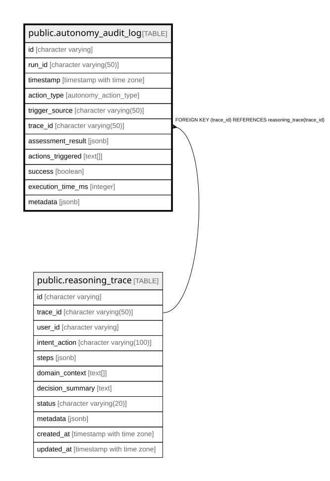

# public.autonomy_audit_log

## Columns

| Name | Type | Default | Nullable | Children | Parents | Comment |
| ---- | ---- | ------- | -------- | -------- | ------- | ------- |
| id | character varying | gen_random_uuid() | false |  |  |  |
| run_id | character varying(50) |  | false |  |  |  |
| timestamp | timestamp with time zone | now() | false |  |  |  |
| action_type | autonomy_action_type |  | false |  |  |  |
| trigger_source | character varying(50) |  | false |  |  |  |
| trace_id | character varying(50) |  | true |  | [public.reasoning_trace](public.reasoning_trace.md) |  |
| assessment_result | jsonb |  | false |  |  |  |
| actions_triggered | text[] | ARRAY[]::text[] | true |  |  |  |
| success | boolean |  | false |  |  |  |
| execution_time_ms | integer |  | true |  |  |  |
| metadata | jsonb |  | true |  |  |  |

## Viewpoints

| Name | Definition |
| ---- | ---------- |
| [public schema](viewpoint-schema-public.md) | All mapped relations in public. |

## Constraints

| Name | Type | Definition |
| ---- | ---- | ---------- |
| autonomy_audit_log_pkey | PRIMARY KEY | PRIMARY KEY (id) |
| autonomy_audit_log_trace_id_reasoning_trace_trace_id_fk | FOREIGN KEY | FOREIGN KEY (trace_id) REFERENCES reasoning_trace(trace_id) |

## Indexes

| Name | Definition |
| ---- | ---------- |
| autonomy_audit_log_action_type_idx | CREATE INDEX autonomy_audit_log_action_type_idx ON public.autonomy_audit_log USING btree (action_type) |
| autonomy_audit_log_pkey | CREATE UNIQUE INDEX autonomy_audit_log_pkey ON public.autonomy_audit_log USING btree (id) |
| autonomy_audit_log_run_id_idx | CREATE INDEX autonomy_audit_log_run_id_idx ON public.autonomy_audit_log USING btree (run_id) |
| autonomy_audit_log_timestamp_idx | CREATE INDEX autonomy_audit_log_timestamp_idx ON public.autonomy_audit_log USING btree ("timestamp") |
| autonomy_audit_log_trace_id_idx | CREATE INDEX autonomy_audit_log_trace_id_idx ON public.autonomy_audit_log USING btree (trace_id) |

## Relations

---

> Generated by [tbls](https://github.com/k1LoW/tbls)
