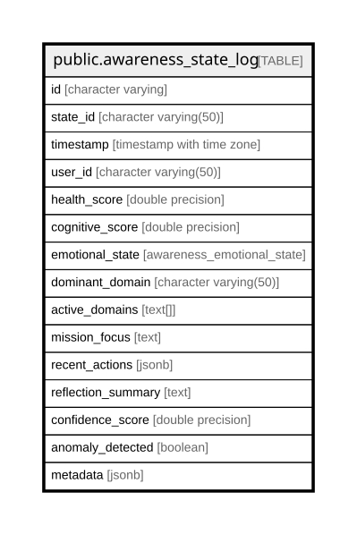

# public.awareness_state_log

## Columns

| Name | Type | Default | Nullable | Children | Parents | Comment |
| ---- | ---- | ------- | -------- | -------- | ------- | ------- |
| id | character varying | gen_random_uuid() | false |  |  |  |
| state_id | character varying(50) |  | false |  |  |  |
| timestamp | timestamp with time zone | now() | false |  |  |  |
| user_id | character varying(50) |  | true |  |  |  |
| health_score | double precision |  | false |  |  |  |
| cognitive_score | double precision |  | false |  |  |  |
| emotional_state | awareness_emotional_state |  | false |  |  |  |
| dominant_domain | character varying(50) |  | true |  |  |  |
| active_domains | text[] | ARRAY[]::text[] | true |  |  |  |
| mission_focus | text |  | true |  |  |  |
| recent_actions | jsonb |  | true |  |  |  |
| reflection_summary | text |  | true |  |  |  |
| confidence_score | double precision |  | true |  |  |  |
| anomaly_detected | boolean | false | true |  |  |  |
| metadata | jsonb |  | true |  |  |  |

## Viewpoints

| Name | Definition |
| ---- | ---------- |
| [public schema](viewpoint-schema-public.md) | All mapped relations in public. |

## Constraints

| Name | Type | Definition |
| ---- | ---- | ---------- |
| awareness_state_log_pkey | PRIMARY KEY | PRIMARY KEY (id) |
| awareness_state_log_state_id_unique | UNIQUE | UNIQUE (state_id) |

## Indexes

| Name | Definition |
| ---- | ---------- |
| awareness_state_log_emotional_state_idx | CREATE INDEX awareness_state_log_emotional_state_idx ON public.awareness_state_log USING btree (emotional_state) |
| awareness_state_log_pkey | CREATE UNIQUE INDEX awareness_state_log_pkey ON public.awareness_state_log USING btree (id) |
| awareness_state_log_state_id_idx | CREATE INDEX awareness_state_log_state_id_idx ON public.awareness_state_log USING btree (state_id) |
| awareness_state_log_state_id_unique | CREATE UNIQUE INDEX awareness_state_log_state_id_unique ON public.awareness_state_log USING btree (state_id) |
| awareness_state_log_timestamp_idx | CREATE INDEX awareness_state_log_timestamp_idx ON public.awareness_state_log USING btree ("timestamp") |
| awareness_state_log_user_id_idx | CREATE INDEX awareness_state_log_user_id_idx ON public.awareness_state_log USING btree (user_id) |

## Relations

---

> Generated by [tbls](https://github.com/k1LoW/tbls)
