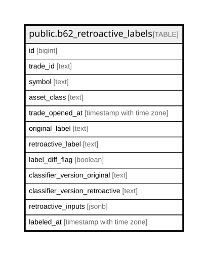

# public.b62_retroactive_labels

## Columns

| Name | Type | Default | Nullable | Children | Parents | Comment |
| ---- | ---- | ------- | -------- | -------- | ------- | ------- |
| id | bigint | nextval('b62_retroactive_labels_id_seq'::regclass) | false |  |  |  |
| trade_id | text |  | false |  |  |  |
| symbol | text |  | false |  |  |  |
| asset_class | text |  | false |  |  |  |
| trade_opened_at | timestamp with time zone |  | false |  |  |  |
| original_label | text |  | true |  |  |  |
| retroactive_label | text |  | true |  |  |  |
| label_diff_flag | boolean |  | false |  |  |  |
| classifier_version_original | text |  | true |  |  |  |
| classifier_version_retroactive | text |  | true |  |  |  |
| retroactive_inputs | jsonb | '{"schema_version": 1}'::jsonb | false |  |  |  |
| labeled_at | timestamp with time zone | now() | false |  |  |  |

## Viewpoints

| Name | Definition |
| ---- | ---------- |
| [public schema](viewpoint-schema-public.md) | All mapped relations in public. |

## Constraints

| Name | Type | Definition |
| ---- | ---- | ---------- |
| b62_retroactive_labels_pkey | PRIMARY KEY | PRIMARY KEY (id) |
| b62_retroactive_labels_trade_id_key | UNIQUE | UNIQUE (trade_id) |

## Indexes

| Name | Definition |
| ---- | ---------- |
| b62_retroactive_labels_diff | CREATE INDEX b62_retroactive_labels_diff ON public.b62_retroactive_labels USING btree (label_diff_flag, retroactive_label) |
| b62_retroactive_labels_opened | CREATE INDEX b62_retroactive_labels_opened ON public.b62_retroactive_labels USING btree (trade_opened_at DESC) |
| b62_retroactive_labels_pkey | CREATE UNIQUE INDEX b62_retroactive_labels_pkey ON public.b62_retroactive_labels USING btree (id) |
| b62_retroactive_labels_trade_id_key | CREATE UNIQUE INDEX b62_retroactive_labels_trade_id_key ON public.b62_retroactive_labels USING btree (trade_id) |

## Relations

---

> Generated by [tbls](https://github.com/k1LoW/tbls)
