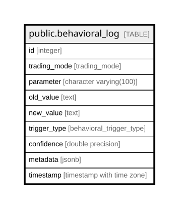

# public.behavioral_log

## Columns

| Name | Type | Default | Nullable | Children | Parents | Comment |
| ---- | ---- | ------- | -------- | -------- | ------- | ------- |
| id | integer | nextval('behavioral_log_id_seq'::regclass) | false |  |  |  |
| trading_mode | trading_mode |  | false |  |  |  |
| parameter | character varying(100) |  | false |  |  |  |
| old_value | text |  | true |  |  |  |
| new_value | text |  | false |  |  |  |
| trigger_type | behavioral_trigger_type |  | false |  |  |  |
| confidence | double precision | 0.5 | false |  |  |  |
| metadata | jsonb |  | true |  |  |  |
| timestamp | timestamp with time zone | now() | false |  |  |  |

## Viewpoints

| Name | Definition |
| ---- | ---------- |
| [public schema](viewpoint-schema-public.md) | All mapped relations in public. |

## Constraints

| Name | Type | Definition |
| ---- | ---- | ---------- |
| behavioral_log_pkey | PRIMARY KEY | PRIMARY KEY (id) |

## Indexes

| Name | Definition |
| ---- | ---------- |
| behavioral_log_mode_idx | CREATE INDEX behavioral_log_mode_idx ON public.behavioral_log USING btree (trading_mode) |
| behavioral_log_parameter_idx | CREATE INDEX behavioral_log_parameter_idx ON public.behavioral_log USING btree (parameter) |
| behavioral_log_pkey | CREATE UNIQUE INDEX behavioral_log_pkey ON public.behavioral_log USING btree (id) |
| behavioral_log_timestamp_idx | CREATE INDEX behavioral_log_timestamp_idx ON public.behavioral_log USING btree ("timestamp") |
| behavioral_log_trigger_idx | CREATE INDEX behavioral_log_trigger_idx ON public.behavioral_log USING btree (trigger_type) |

## Relations

---

> Generated by [tbls](https://github.com/k1LoW/tbls)
