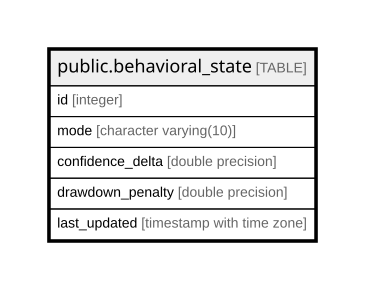

# public.behavioral_state

## Columns

| Name | Type | Default | Nullable | Children | Parents | Comment |
| ---- | ---- | ------- | -------- | -------- | ------- | ------- |
| id | integer | nextval('behavioral_state_id_seq'::regclass) | false |  |  |  |
| mode | character varying(10) |  | false |  |  |  |
| confidence_delta | double precision | 0.0 | false |  |  |  |
| drawdown_penalty | double precision | 0.0 | false |  |  |  |
| last_updated | timestamp with time zone | CURRENT_TIMESTAMP | false |  |  |  |

## Viewpoints

| Name | Definition |
| ---- | ---------- |
| [public schema](viewpoint-schema-public.md) | All mapped relations in public. |

## Constraints

| Name | Type | Definition |
| ---- | ---- | ---------- |
| behavioral_state_mode_key | UNIQUE | UNIQUE (mode) |
| behavioral_state_pkey | PRIMARY KEY | PRIMARY KEY (id) |

## Indexes

| Name | Definition |
| ---- | ---------- |
| behavioral_state_mode_idx | CREATE INDEX behavioral_state_mode_idx ON public.behavioral_state USING btree (mode) |
| behavioral_state_mode_key | CREATE UNIQUE INDEX behavioral_state_mode_key ON public.behavioral_state USING btree (mode) |
| behavioral_state_pkey | CREATE UNIQUE INDEX behavioral_state_pkey ON public.behavioral_state USING btree (id) |

## Relations

---

> Generated by [tbls](https://github.com/k1LoW/tbls)
