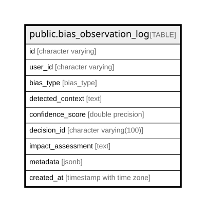

# public.bias_observation_log

## Columns

| Name | Type | Default | Nullable | Children | Parents | Comment |
| ---- | ---- | ------- | -------- | -------- | ------- | ------- |
| id | character varying | gen_random_uuid() | false |  |  |  |
| user_id | character varying |  | true |  |  |  |
| bias_type | bias_type |  | false |  |  |  |
| detected_context | text |  | false |  |  |  |
| confidence_score | double precision |  | false |  |  |  |
| decision_id | character varying(100) |  | true |  |  |  |
| impact_assessment | text |  | true |  |  |  |
| metadata | jsonb |  | true |  |  |  |
| created_at | timestamp with time zone | now() | false |  |  |  |

## Viewpoints

| Name | Definition |
| ---- | ---------- |
| [public schema](viewpoint-schema-public.md) | All mapped relations in public. |

## Constraints

| Name | Type | Definition |
| ---- | ---- | ---------- |
| bias_observation_log_pkey | PRIMARY KEY | PRIMARY KEY (id) |

## Indexes

| Name | Definition |
| ---- | ---------- |
| bias_observation_log_bias_type_idx | CREATE INDEX bias_observation_log_bias_type_idx ON public.bias_observation_log USING btree (bias_type) |
| bias_observation_log_created_at_idx | CREATE INDEX bias_observation_log_created_at_idx ON public.bias_observation_log USING btree (created_at) |
| bias_observation_log_pkey | CREATE UNIQUE INDEX bias_observation_log_pkey ON public.bias_observation_log USING btree (id) |
| bias_observation_log_user_id_idx | CREATE INDEX bias_observation_log_user_id_idx ON public.bias_observation_log USING btree (user_id) |

## Relations

---

> Generated by [tbls](https://github.com/k1LoW/tbls)
