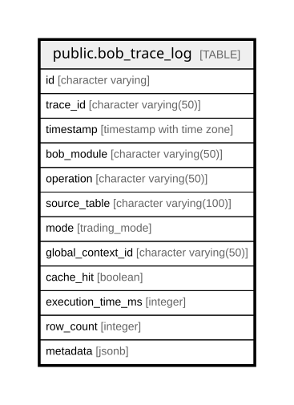

# public.bob_trace_log

## Columns

| Name | Type | Default | Nullable | Children | Parents | Comment |
| ---- | ---- | ------- | -------- | -------- | ------- | ------- |
| id | character varying | gen_random_uuid() | false |  |  |  |
| trace_id | character varying(50) |  | false |  |  |  |
| timestamp | timestamp with time zone | now() | false |  |  |  |
| bob_module | character varying(50) |  | false |  |  |  |
| operation | character varying(50) |  | false |  |  |  |
| source_table | character varying(100) |  | true |  |  |  |
| mode | trading_mode |  | true |  |  |  |
| global_context_id | character varying(50) |  | true |  |  |  |
| cache_hit | boolean |  | true |  |  |  |
| execution_time_ms | integer |  | true |  |  |  |
| row_count | integer |  | true |  |  |  |
| metadata | jsonb |  | true |  |  |  |

## Viewpoints

| Name | Definition |
| ---- | ---------- |
| [public schema](viewpoint-schema-public.md) | All mapped relations in public. |

## Constraints

| Name | Type | Definition |
| ---- | ---- | ---------- |
| bob_trace_log_pkey | PRIMARY KEY | PRIMARY KEY (id) |

## Indexes

| Name | Definition |
| ---- | ---------- |
| bob_trace_log_bob_module_idx | CREATE INDEX bob_trace_log_bob_module_idx ON public.bob_trace_log USING btree (bob_module) |
| bob_trace_log_pkey | CREATE UNIQUE INDEX bob_trace_log_pkey ON public.bob_trace_log USING btree (id) |
| bob_trace_log_timestamp_idx | CREATE INDEX bob_trace_log_timestamp_idx ON public.bob_trace_log USING btree ("timestamp") |
| bob_trace_log_trace_id_idx | CREATE INDEX bob_trace_log_trace_id_idx ON public.bob_trace_log USING btree (trace_id) |

## Relations

---

> Generated by [tbls](https://github.com/k1LoW/tbls)
