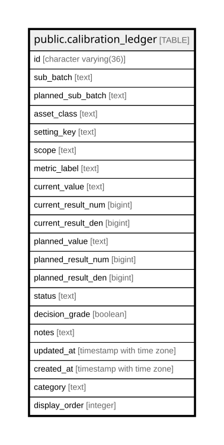

# public.calibration_ledger

## Columns

| Name | Type | Default | Nullable | Children | Parents | Comment |
| ---- | ---- | ------- | -------- | -------- | ------- | ------- |
| id | character varying(36) | (gen_random_uuid())::text | false |  |  |  |
| sub_batch | text |  | false |  |  |  |
| planned_sub_batch | text |  | true |  |  |  |
| asset_class | text | 'xstock_spot'::text | false |  |  |  |
| setting_key | text |  | false |  |  |  |
| scope | text | '*'::text | false |  |  |  |
| metric_label | text |  | false |  |  |  |
| current_value | text |  | true |  |  |  |
| current_result_num | bigint |  | true |  |  |  |
| current_result_den | bigint |  | true |  |  |  |
| planned_value | text |  | true |  |  |  |
| planned_result_num | bigint |  | true |  |  |  |
| planned_result_den | bigint |  | true |  |  |  |
| status | text | 'baseline'::text | false |  |  |  |
| decision_grade | boolean | true | false |  |  |  |
| notes | text |  | true |  |  |  |
| updated_at | timestamp with time zone | now() | false |  |  |  |
| created_at | timestamp with time zone | now() | false |  |  |  |
| category | text |  | true |  |  |  |
| display_order | integer |  | true |  |  |  |

## Viewpoints

| Name | Definition |
| ---- | ---------- |
| [public schema](viewpoint-schema-public.md) | All mapped relations in public. |

## Constraints

| Name | Type | Definition |
| ---- | ---- | ---------- |
| calibration_ledger_pkey | PRIMARY KEY | PRIMARY KEY (id) |

## Indexes

| Name | Definition |
| ---- | ---------- |
| calibration_ledger_asset_class_idx | CREATE INDEX calibration_ledger_asset_class_idx ON public.calibration_ledger USING btree (asset_class) |
| calibration_ledger_grain_idx | CREATE UNIQUE INDEX calibration_ledger_grain_idx ON public.calibration_ledger USING btree (sub_batch, asset_class, setting_key, scope) |
| calibration_ledger_pkey | CREATE UNIQUE INDEX calibration_ledger_pkey ON public.calibration_ledger USING btree (id) |

## Relations

---

> Generated by [tbls](https://github.com/k1LoW/tbls)
