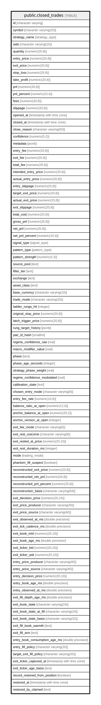

# public.closed_trades

## Columns

| Name | Type | Default | Nullable | Children | Parents | Comment |
| ---- | ---- | ------- | -------- | -------- | ------- | ------- |
| id | character varying | gen_random_uuid() | false |  |  |  |
| symbol | character varying(20) |  | false |  |  |  |
| strategy_name | strategy_type |  | false |  |  |  |
| side | character varying(10) |  | false |  |  |  |
| quantity | numeric(20,8) |  | false |  |  |  |
| entry_price | numeric(20,8) |  | false |  |  |  |
| exit_price | numeric(20,8) |  | true |  |  |  |
| stop_loss | numeric(20,8) |  | true |  |  |  |
| take_profit | numeric(20,8) |  | true |  |  |  |
| pnl | numeric(20,8) |  | true |  |  |  |
| pnl_percent | numeric(10,4) |  | true |  |  |  |
| fees | numeric(20,8) |  | true |  |  |  |
| slippage | numeric(20,8) |  | true |  |  |  |
| opened_at | timestamp with time zone |  | false |  |  |  |
| closed_at | timestamp with time zone |  | true |  |  |  |
| close_reason | character varying(50) |  | true |  |  |  |
| confidence | numeric(5,2) |  | true |  |  |  |
| metadata | jsonb |  | true |  |  |  |
| entry_fee | numeric(20,8) |  | true |  |  |  |
| exit_fee | numeric(20,8) |  | true |  |  |  |
| total_fee | numeric(20,8) |  | true |  |  |  |
| intended_entry_price | numeric(20,8) |  | true |  |  |  |
| actual_entry_price | numeric(20,8) |  | true |  |  |  |
| entry_slippage | numeric(20,8) |  | true |  |  |  |
| target_exit_price | numeric(20,8) |  | true |  |  |  |
| actual_exit_price | numeric(20,8) |  | true |  |  |  |
| exit_slippage | numeric(20,8) |  | true |  |  |  |
| total_cost | numeric(20,8) |  | true |  |  |  |
| gross_pnl | numeric(20,8) |  | true |  |  |  |
| net_pnl | numeric(20,8) |  | true |  |  |  |
| net_pnl_percent | numeric(10,4) |  | true |  |  |  |
| signal_type | signal_type | 'QUANT'::signal_type | false |  |  |  |
| pattern_type | pattern_type |  | true |  |  |  |
| pattern_strength | numeric(4,3) |  | true |  |  |  |
| source_pool | text |  | true |  |  |  |
| filter_tier | text |  | true |  |  |  |
| exchange | text | 'kraken'::text | false |  |  |  |
| asset_class | text |  | false |  |  |  |
| base_currency | character varying(10) |  | false |  |  |  |
| trade_mode | character varying(20) | 'TARGET'::character varying | false |  |  | B65.2 (2026-04-23): preserves the trailing-exit mode the trade ended in. TARGET = closed at static target (or stop/timeout); TRAILING_TAKE = entered moonbag (trailing) mode and closed via trailing_stop_hit or moonbag_timeout. |
| ladder_rungs_hit | integer | 0 | false |  |  | B65.4 (2026-04-25): number of ladder-rung target ratchets the trade hit before closing. 0 = closed at original target/stop without entering moonbag (or qualifier rejected). 1+ = trade ran past N rung targets in moonbag mode before reversing through the ratcheted stop. |
| original_stop_price | numeric(20,8) |  | true |  |  |  |
| latch_trigger_price | numeric(20,8) |  | true |  |  |  |
| rung_target_history | jsonb |  | true |  |  |  |
| pair_id_hash | smallint |  | true |  |  |  |
| regime_confidence_raw | real |  | true |  |  |  |
| macro_modifier_value | real |  | true |  |  |  |
| phase | text |  | true |  |  |  |
| phase_age_seconds | integer |  | true |  |  |  |
| strategy_phase_weight | real |  | true |  |  |  |
| regime_confidence_modulated | real |  | true |  |  |  |
| calibration_state | text | 'pre_calibration_xstock_2026_05'::text | false |  |  | P19-B4a C6 (2026-06-14): calibration-era marker for active-paper trades. Default 'pre_calibration_xstock_2026_05' tags every trade opened during the xStock calibration umbrella; the xStocks aggregator excludes this cohort when scoped to xstock_spot. Mirror of the VTS-side F-NOW column. Flip to a post-calibration value is a future action (clean-dataset boundary). |
| chosen_entry_mode | character varying(8) |  | true |  |  |  |
| entry_fee_rate | numeric(10,6) |  | true |  |  |  |
| balance_ratio_at_open | numeric(12,6) |  | true |  |  |  |
| anchor_balance_at_open | numeric(20,2) |  | true |  |  |  |
| anchor_version_at_open | integer |  | true |  |  |  |
| exit_fee_mode | character varying(8) |  | true |  |  |  |
| exit_rest_outcome | character varying(8) |  | true |  |  |  |
| exit_rested_at_price | numeric(20,10) |  | true |  |  |  |
| exit_rest_duration_ms | integer |  | true |  |  |  |
| mode | trading_mode |  | false |  |  |  |
| phantom_fill_suspect | boolean | false | false |  |  | B-PHANTOM-FILL-RECONSTRUCT (#741). ⛔ false + reconstruction_basis IS NULL means NOT ASSESSED — it does NOT mean assessed-clean. Every pre-F-E row is in that state. Only F-E may set true, and it must also set reconstruction_basis so the two states are distinguishable. Reading false as clean is the #546 failure this comment exists to prevent. |
| reconstructed_exit_price | numeric(20,8) |  | true |  |  |  |
| reconstructed_net_pnl | numeric(20,8) |  | true |  |  | The honest P&L had the fill occurred at a price the venue actually printed. NULL until F-E populates it. The recorded pnl/net_pnl are NEVER overwritten — Kyle: "flag and remove from our accounts, but we do not delete these trades". |
| reconstructed_pnl_percent | numeric(20,8) |  | true |  |  |  |
| reconstruction_basis | character varying(64) |  | true |  |  | How the reconstruction was derived, or NULL for NOT ASSESSED. The tri-state carrier: (false, NULL) = not assessed; (false, \<basis\>) = assessed clean; (true, \<basis\>) = assessed contaminated. Never infer assessment from phantom_fill_suspect alone. |
| exit_decision_price | numeric(20,10) |  | true |  |  | The value that actually DROVE the exit. NOT always exit_price: a resting maker exit records its limit while currentPrice caused the close. B-EXIT-PROVENANCE. |
| exit_price_producer | character varying(40) |  | true |  |  | WHICH HANDLER produced the exit price, AND since 2026-08-30 which KIND of number it was. Closed vocabulary (PriceProducer, live-pricing-adapter.ts); a value outside it FAILS the OBJ-5 fence. SPLIT EPOCH 2026-08-30: kraken_ws_ticker, kraken_equities_ws and kraken_rest_engine_fallback each became _mid/_last. Rows before that epoch carry the coarse names and are NOT wrong, only coarse - a cohort query spanning the epoch MUST ENUMERATE both old and new members and must NEVER use LIKE, because kraken_ws_ticker is a strict prefix of kraken_ws_ticker_v1 and _ is itself a LIKE wildcard. A _mid suffix records the KIND and says NOTHING about WHICH BBO produced it (#952 is open). B-EXIT-PROVENANCE / B-EXIT-BOOK-AGE-STAMP. |
| exit_price_source | character varying(40) |  | true |  |  | POLICY label (may the engine act on this price?). The one non-null guarantee on a POST-DEPLOY row; NULL on pre-deploy rows by design (#546). B-EXIT-PROVENANCE. |
| exit_observed_at_ms | double precision |  | true |  |  | Venue OBSERVATION time of the exit-driving price. NULL where the leg genuinely has none (crypto direct-REST). NEVER inter-tick cadence — that is exit_tick_cadence_ms. B-EXIT-PROVENANCE. |
| exit_tick_cadence_ms | double precision |  | true |  |  | Engine inter-tick cadence for this symbol. Named honestly: it was priceAgeMs, which never held an age. B-EXIT-PROVENANCE. |
| exit_book_mid | numeric(20,10) |  | true |  |  | DECISION-time order-book mid from the crypto WS mini-book - independent cross-check. NULL BY CONSTRUCTION on xStock because getBookForFill has no xStock equivalent, not by omission and not because the class has no book. Same instant as exit_book_age_ms. B-EXIT-PROVENANCE, bounded by B-EXIT-BOOK-AGE-STAMP. |
| exit_book_age_ms | double precision |  | true |  |  | DECISION-time age of the crypto WS mini-book (getBookForFill), captured once per position ABOVE the exit-condition evaluation - NOT at the close. NULL BY CONSTRUCTION on xStock because that accessor has no xStock equivalent; this is NOT a claim that xStock has no book (see exit_fill_depth_age_ms, which IS populated on xStock). NOT comparable to entry_book_age_ms (a depth-GATE reading) or exit_fill_depth_age_ms (the fill) - THREE DIFFERENT INSTANTS. B-EXIT-PROVENANCE, bounded by B-EXIT-BOOK-AGE-STAMP. |
| exit_ticker_bid | numeric(20,10) |  | true |  |  | INSTRUMENTED since #911 (2026-08-27): read from the archiver ticker snapshot via getTickerWitness, NOT from the depth snapshot the fill walks. A NULL here means NO WITNESS ROW - it does NOT mean "not instrumented", and it never means "no ticker existed". NEVER fill this from the order book: top-of-book is a DIFFERENT feed, and #741 is a BOOK defect, so a row with a book mid and no ticker checks the suspect against itself. NOT independent on xStock - the fill reads the same table. B-EXIT-PROVENANCE / #911. |
| exit_ticker_ask | numeric(20,10) |  | true |  |  | INSTRUMENTED since #911 (2026-08-27) - see exit_ticker_bid. A NULL means no witness row, not "not instrumented". B-EXIT-PROVENANCE / #911. |
| entry_price_producer | character varying(40) |  | true |  |  | WHICH HANDLER produced the entry price, written AT THE FILL SEAM, never at placement (a maker is INSERTED at placement and OPENS later). B-EXIT-PROVENANCE. |
| entry_price_source | character varying(40) |  | true |  |  |  |
| entry_decision_price | numeric(20,10) |  | true |  |  |  |
| entry_book_age_ms | double precision |  | true |  |  | DEPTH-GATE age, not the fill instant: the snapshot is taken by _evaluateOpenDepthGate and the walk that consumes it runs ~150 lines and THREE awaits later, one a venue round-trip. NULL BY CONSTRUCTION on a MAKER-fill row (a resting fill consults no depth). NOT THE SAME QUANTITY ACROSS CLASSES: on xstock_spot this is a ticker-snap ROW AGE, not an order-book age. B-EXIT-PROVENANCE, corrected by B-EXIT-BOOK-AGE-STAMP. |
| entry_observed_at_ms | double precision |  | true |  |  |  |
| exit_fill_depth_age_ms | double precision |  | true |  |  | Age of the depth snapshot the FILL actually walked, taken two lines before the walk with no await between - the tightest of this table's three age columns. NOT THE SAME QUANTITY ACROSS CLASSES: crypto_spot = live WS mini-book age; xstock_spot = ROW AGE of an xstock_spot_ticker_snap record (NOW() - captured_at). A row age and a book age are different measurements - never pool them. DISCRIMINATE ON closed_trades.asset_class, which is NOT NULL and is on this row; DepthSnapshot.source is the in-process form and is never persisted. A NULL IS FOUR-VALUED and exit_fee_mode does NOT separate them alone - that column has exactly one writer, inside closePosition, so any close not routed through there lands NULL/NULL. fee_mode=maker: a resting fill consulted no depth. fee_mode=taker: the walk ran and getDepthSnapshot returned null (cold or one-sided book). fee_mode IS NULL: the row came from a non-closePosition path (never_filled, closeAllPositions, engine_stop_cleanup, hard_reset, the two manual routes) or predates this column - use close_reason and closed_at for those, never the fee mode. B-EXIT-BOOK-AGE-STAMP. |
| exit_book_state | character varying(24) |  | true |  |  | B-XSTOCK-FEED-SANITY (#943): what the book looked like at the DECISION instant - two_sided \| hollow \| unknown (unknown = the guard LOOKED and had no comparator yet). A LABEL, never money: HONEST_PNL, gross/net, the daily-loss budget and close_reason are untouched. NEVER read without exit_book_state_basis. NULL = no assessment happened: pre-deploy, crypto (no guard), guard disabled / knobs cold / no tick, a flatten that carried no decision verdict, never_filled, engine_stop_cleanup, hard_reset. A NULL is re-cuttable; a value is a look that happened. |
| exit_book_state_at_fill | character varying(24) |  | true |  |  | B-XSTOCK-FEED-SANITY (#943): the same verdict at the FILL instant (closePosition, before the depth read). Written ONLY by the live assessment there, so its basis is guard by construction and it has no basis column. A resting maker fill consulted no book =\> NULL (no assessment, not unknown). Writers outside closePosition (closeAllPositions, the two manual routes) stamp exit_book_state at their own write and leave this NULL. |
| exit_book_state_basis | character varying(32) |  | true |  |  | B-XSTOCK-FEED-SANITY (#943): what produced exit_book_state - and ONLY exit_book_state (INVARIANT: a non-NULL basis implies a non-NULL exit_book_state; the re-cut touches only rows where BOTH are NULL). guard = a LIVE in-memory frame WAS ASSESSED at the decision instant (the ONLY basis that saw the decision frame) - written only when that is true, never for a guard that did not run; decision_price = this row's exit_decision_price judged against the archive; market_state_predicate = the archived frame \<=5s before close (session bodies only - the archive keeps ONE row per symbol per 4s and misses the handoff decision frames: audit A.11, 2 of 11 handoff closes reproduced vs 10 of 10 bodies); minute_proxy = the close fell in a handoff minute and nothing else is known - a PROXY with an UNMEASURED base rate (26 rows at deploy). A consumer that gates on hollow MUST also require basis IN (guard, decision_price); the fence test enforces it. |
| exit_fill_book_warmth | text |  | true |  |  | WARMTH of the book the taker CLOSE fill walked, graded by assessWarmth against fill_depth_gate.warmth_max_age_ms / min_levels at the fill instant: warm \| stale_book \| thin_book \| no_book. NULL on a MAKER fill (a resting fill consults no book) and on rows not written by closePosition. ORTHOGONAL TO exit_book_state_at_fill, which answers HOLLOWNESS (two_sided \| hollow \| unknown): a book can be warm and hollow, or stale and two-sided. Both are kept. The age itself stays in exit_fill_depth_age_ms. B-FEED-MISMATCH-FIX P1. |
| exit_fill_arm | text |  | true |  |  | Which arm of the close-fill contract booked this close: walk (warm book) \| walk_stale (not warm, walked fill within up_tol of the witness bid) \| walk_no_reference (not warm, no witness bid to grade against - e.g. EUR-quoted pairs, #966) \| walk_yield (not warm and refused, cold_refusal_cap reached - walked anyway, alerted) \| flatten_walk (stopped-engine flatten walked a book within up_tol, or a warm one) \| flatten_walk_diverged (stopped-engine flatten walked a not-warm book above up_tol, or with the contract unseeded - booked because a flatten must go flat; EXCLUDED from learning capture) \| synthetic_reference (stopped-engine flatten, no book: booked at the resolved observed price minus the beyond-depth penalty; EXCLUDED from learning capture). NULL on maker fills and on rows not written by closePosition - EXCEPT the stop-time reconciler (close_reason = engine_stop_cleanup), which also writes synthetic_reference for a trade row it books at an observed quote; those rows carry NO fee and NO penalty, so discriminate on close_reason, never on this column alone. B-FEED-MISMATCH-FIX P1/P2/P4. |
| entry_book_consumption_age_ms | double precision |  | true |  |  | Conservative age of the SAME depth snapshot immediately before an immediate entry depth walk: source-reported gate age plus process-monotonic elapsed time from a pre-source-read anchor. NULL for pre-cutover rows and pending-maker placement, which does not consume depth. Separate from entry_book_age_ms, the first-gate reading. Crypto and xStock retain their existing class-specific source semantics and must not be pooled. B-ENTRY-CONSUMPTION-FRESHNESS. |
| entry_fill_policy | character varying(20) |  | true |  |  |  |
| target_exit_fill_policy | character varying(20) |  | true |  |  |  |
| exit_ticker_captured_at | timestamp with time zone |  | true |  |  | WHEN the ticker witness in exit_ticker_bid/ask was captured (the recorder row's captured_at). Age = closed_at - exit_ticker_captured_at. NULL when no witness was stored, or when exit_ticker_age_basis = underivable. B-CRYPTO-FEED-WATCHDOG #1232: on 2026-10-21 -\> 11-04 thirteen crypto closes carried a witness 2-13 days old with no way to tell. |
| exit_ticker_age_basis | text |  | true |  |  | How exit_ticker_captured_at was known: at_close (stamped by closePosition from getTickerWitness().capturedAtMs) \| backfill_matched (derived by matching the stored bid/ask to the recorder row, exact numeric equality, captured_at \<= closed_at) \| underivable (no matching row could be found). NULL when no witness was stored. B-CRYPTO-FEED-WATCHDOG #1232. |
| record_restored_from_position | boolean | false | false |  |  |  |
| restored_at | timestamp with time zone |  | true |  |  |  |
| restored_by_claimed | text |  | true |  |  |  |

## Viewpoints

| Name | Definition |
| ---- | ---------- |
| [public schema](viewpoint-schema-public.md) | All mapped relations in public. |

## Constraints

| Name | Type | Definition |
| ---- | ---- | ---------- |
| paper_sim_trades_phase_check | CHECK | CHECK (phase IS NULL OR (phase = ANY (ARRAY['EARLY'::text, 'PRIME'::text, 'LATE'::text]))) |
| paper_sim_trades_pkey | PRIMARY KEY | PRIMARY KEY (id) |
| paper_sim_trades_trade_mode_chk | CHECK | CHECK (trade_mode::text = ANY (ARRAY['TARGET'::character varying, 'TRAILING_TAKE'::character varying]::text[])) |

## Indexes

| Name | Definition |
| ---- | ---------- |
| closed_trades_closed_at_idx | CREATE INDEX closed_trades_closed_at_idx ON public.closed_trades USING btree (closed_at) |
| closed_trades_opened_at_idx | CREATE INDEX closed_trades_opened_at_idx ON public.closed_trades USING btree (opened_at) |
| closed_trades_phantom_suspect_idx | CREATE INDEX closed_trades_phantom_suspect_idx ON public.closed_trades USING btree (phantom_fill_suspect) WHERE phantom_fill_suspect |
| closed_trades_strategy_idx | CREATE INDEX closed_trades_strategy_idx ON public.closed_trades USING btree (strategy_name) |
| paper_sim_trades_pkey | CREATE UNIQUE INDEX paper_sim_trades_pkey ON public.closed_trades USING btree (id) |

## Relations

---

> Generated by [tbls](https://github.com/k1LoW/tbls)
