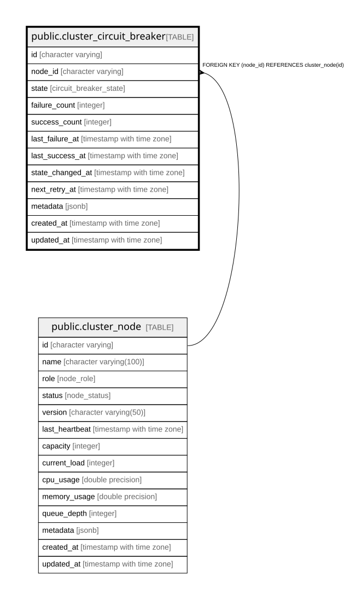

# public.cluster_circuit_breaker

## Columns

| Name | Type | Default | Nullable | Children | Parents | Comment |
| ---- | ---- | ------- | -------- | -------- | ------- | ------- |
| id | character varying | gen_random_uuid() | false |  |  |  |
| node_id | character varying |  | false |  | [public.cluster_node](public.cluster_node.md) |  |
| state | circuit_breaker_state | 'closed'::circuit_breaker_state | false |  |  |  |
| failure_count | integer | 0 | false |  |  |  |
| success_count | integer | 0 | false |  |  |  |
| last_failure_at | timestamp with time zone |  | true |  |  |  |
| last_success_at | timestamp with time zone |  | true |  |  |  |
| state_changed_at | timestamp with time zone | now() | false |  |  |  |
| next_retry_at | timestamp with time zone |  | true |  |  |  |
| metadata | jsonb |  | true |  |  |  |
| created_at | timestamp with time zone | now() | false |  |  |  |
| updated_at | timestamp with time zone | now() | false |  |  |  |

## Viewpoints

| Name | Definition |
| ---- | ---------- |
| [public schema](viewpoint-schema-public.md) | All mapped relations in public. |

## Constraints

| Name | Type | Definition |
| ---- | ---- | ---------- |
| cluster_circuit_breaker_node_id_fkey | FOREIGN KEY | FOREIGN KEY (node_id) REFERENCES cluster_node(id) |
| cluster_circuit_breaker_pkey | PRIMARY KEY | PRIMARY KEY (id) |

## Indexes

| Name | Definition |
| ---- | ---------- |
| cluster_circuit_breaker_node_id_idx | CREATE INDEX cluster_circuit_breaker_node_id_idx ON public.cluster_circuit_breaker USING btree (node_id) |
| cluster_circuit_breaker_pkey | CREATE UNIQUE INDEX cluster_circuit_breaker_pkey ON public.cluster_circuit_breaker USING btree (id) |
| cluster_circuit_breaker_state_idx | CREATE INDEX cluster_circuit_breaker_state_idx ON public.cluster_circuit_breaker USING btree (state) |

## Relations

---

> Generated by [tbls](https://github.com/k1LoW/tbls)
