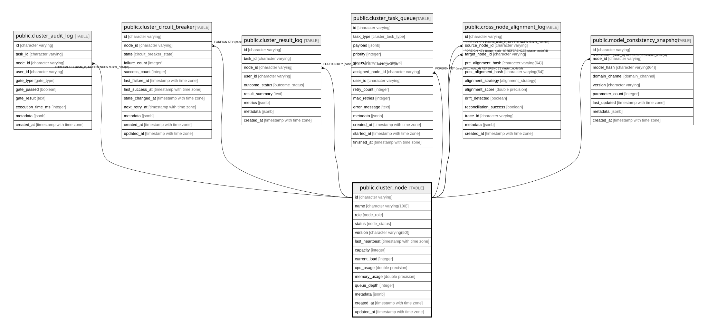

# public.cluster_node

## Columns

| Name | Type | Default | Nullable | Children | Parents | Comment |
| ---- | ---- | ------- | -------- | -------- | ------- | ------- |
| id | character varying | gen_random_uuid() | false | [public.cluster_audit_log](public.cluster_audit_log.md) [public.cluster_circuit_breaker](public.cluster_circuit_breaker.md) [public.cluster_result_log](public.cluster_result_log.md) [public.cluster_task_queue](public.cluster_task_queue.md) [public.cross_node_alignment_log](public.cross_node_alignment_log.md) [public.model_consistency_snapshot](public.model_consistency_snapshot.md) |  |  |
| name | character varying(100) |  | false |  |  |  |
| role | node_role |  | false |  |  |  |
| status | node_status | 'healthy'::node_status | false |  |  |  |
| version | character varying(50) |  | true |  |  |  |
| last_heartbeat | timestamp with time zone | now() | false |  |  |  |
| capacity | integer | 100 | false |  |  |  |
| current_load | integer | 0 | false |  |  |  |
| cpu_usage | double precision |  | true |  |  |  |
| memory_usage | double precision |  | true |  |  |  |
| queue_depth | integer | 0 | false |  |  |  |
| metadata | jsonb |  | true |  |  |  |
| created_at | timestamp with time zone | now() | false |  |  |  |
| updated_at | timestamp with time zone | now() | false |  |  |  |

## Viewpoints

| Name | Definition |
| ---- | ---------- |
| [public schema](viewpoint-schema-public.md) | All mapped relations in public. |

## Constraints

| Name | Type | Definition |
| ---- | ---- | ---------- |
| cluster_node_name_key | UNIQUE | UNIQUE (name) |
| cluster_node_pkey | PRIMARY KEY | PRIMARY KEY (id) |

## Indexes

| Name | Definition |
| ---- | ---------- |
| cluster_node_last_heartbeat_idx | CREATE INDEX cluster_node_last_heartbeat_idx ON public.cluster_node USING btree (last_heartbeat) |
| cluster_node_name_key | CREATE UNIQUE INDEX cluster_node_name_key ON public.cluster_node USING btree (name) |
| cluster_node_pkey | CREATE UNIQUE INDEX cluster_node_pkey ON public.cluster_node USING btree (id) |
| cluster_node_role_idx | CREATE INDEX cluster_node_role_idx ON public.cluster_node USING btree (role) |
| cluster_node_status_idx | CREATE INDEX cluster_node_status_idx ON public.cluster_node USING btree (status) |

## Relations

---

> Generated by [tbls](https://github.com/k1LoW/tbls)
