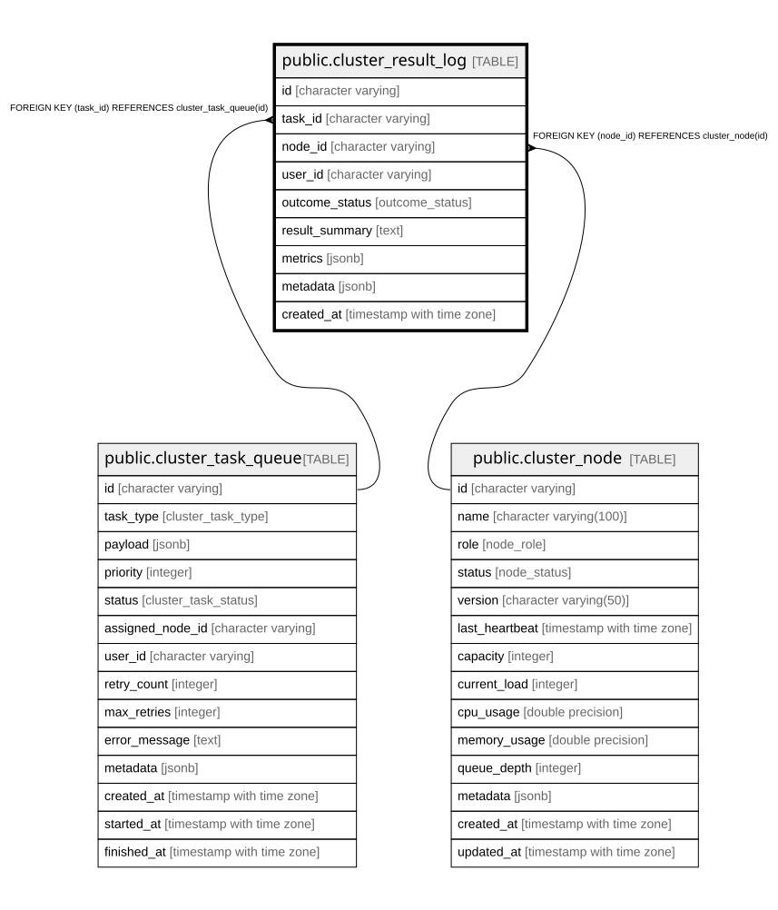

# public.cluster_result_log

## Columns

| Name | Type | Default | Nullable | Children | Parents | Comment |
| ---- | ---- | ------- | -------- | -------- | ------- | ------- |
| id | character varying | gen_random_uuid() | false |  |  |  |
| task_id | character varying |  | false |  | [public.cluster_task_queue](public.cluster_task_queue.md) |  |
| node_id | character varying |  | false |  | [public.cluster_node](public.cluster_node.md) |  |
| user_id | character varying |  | true |  |  |  |
| outcome_status | outcome_status |  | false |  |  |  |
| result_summary | text |  | true |  |  |  |
| metrics | jsonb |  | true |  |  |  |
| metadata | jsonb |  | true |  |  |  |
| created_at | timestamp with time zone | now() | false |  |  |  |

## Viewpoints

| Name | Definition |
| ---- | ---------- |
| [public schema](viewpoint-schema-public.md) | All mapped relations in public. |

## Constraints

| Name | Type | Definition |
| ---- | ---- | ---------- |
| cluster_result_log_node_id_fkey | FOREIGN KEY | FOREIGN KEY (node_id) REFERENCES cluster_node(id) |
| cluster_result_log_pkey | PRIMARY KEY | PRIMARY KEY (id) |
| cluster_result_log_task_id_fkey | FOREIGN KEY | FOREIGN KEY (task_id) REFERENCES cluster_task_queue(id) |

## Indexes

| Name | Definition |
| ---- | ---------- |
| cluster_result_log_created_at_idx | CREATE INDEX cluster_result_log_created_at_idx ON public.cluster_result_log USING btree (created_at) |
| cluster_result_log_node_id_idx | CREATE INDEX cluster_result_log_node_id_idx ON public.cluster_result_log USING btree (node_id) |
| cluster_result_log_outcome_status_idx | CREATE INDEX cluster_result_log_outcome_status_idx ON public.cluster_result_log USING btree (outcome_status) |
| cluster_result_log_pkey | CREATE UNIQUE INDEX cluster_result_log_pkey ON public.cluster_result_log USING btree (id) |
| cluster_result_log_task_id_idx | CREATE INDEX cluster_result_log_task_id_idx ON public.cluster_result_log USING btree (task_id) |
| cluster_result_log_user_id_idx | CREATE INDEX cluster_result_log_user_id_idx ON public.cluster_result_log USING btree (user_id) |

## Relations

---

> Generated by [tbls](https://github.com/k1LoW/tbls)
