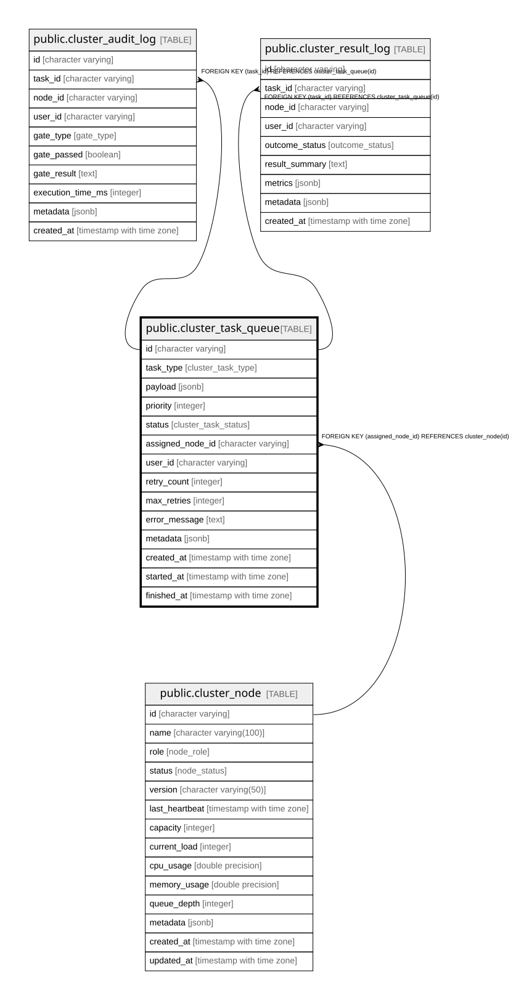

# public.cluster_task_queue

## Columns

| Name | Type | Default | Nullable | Children | Parents | Comment |
| ---- | ---- | ------- | -------- | -------- | ------- | ------- |
| id | character varying | gen_random_uuid() | false | [public.cluster_audit_log](public.cluster_audit_log.md) [public.cluster_result_log](public.cluster_result_log.md) |  |  |
| task_type | cluster_task_type |  | false |  |  |  |
| payload | jsonb |  | false |  |  |  |
| priority | integer | 5 | false |  |  |  |
| status | cluster_task_status | 'queued'::cluster_task_status | false |  |  |  |
| assigned_node_id | character varying |  | true |  | [public.cluster_node](public.cluster_node.md) |  |
| user_id | character varying |  | true |  |  |  |
| retry_count | integer | 0 | false |  |  |  |
| max_retries | integer | 3 | false |  |  |  |
| error_message | text |  | true |  |  |  |
| metadata | jsonb |  | true |  |  |  |
| created_at | timestamp with time zone | now() | false |  |  |  |
| started_at | timestamp with time zone |  | true |  |  |  |
| finished_at | timestamp with time zone |  | true |  |  |  |

## Viewpoints

| Name | Definition |
| ---- | ---------- |
| [public schema](viewpoint-schema-public.md) | All mapped relations in public. |

## Constraints

| Name | Type | Definition |
| ---- | ---- | ---------- |
| cluster_task_queue_assigned_node_id_fkey | FOREIGN KEY | FOREIGN KEY (assigned_node_id) REFERENCES cluster_node(id) |
| cluster_task_queue_pkey | PRIMARY KEY | PRIMARY KEY (id) |

## Indexes

| Name | Definition |
| ---- | ---------- |
| cluster_task_queue_assigned_node_id_idx | CREATE INDEX cluster_task_queue_assigned_node_id_idx ON public.cluster_task_queue USING btree (assigned_node_id) |
| cluster_task_queue_created_at_idx | CREATE INDEX cluster_task_queue_created_at_idx ON public.cluster_task_queue USING btree (created_at) |
| cluster_task_queue_pkey | CREATE UNIQUE INDEX cluster_task_queue_pkey ON public.cluster_task_queue USING btree (id) |
| cluster_task_queue_priority_idx | CREATE INDEX cluster_task_queue_priority_idx ON public.cluster_task_queue USING btree (priority) |
| cluster_task_queue_status_idx | CREATE INDEX cluster_task_queue_status_idx ON public.cluster_task_queue USING btree (status) |
| cluster_task_queue_task_type_idx | CREATE INDEX cluster_task_queue_task_type_idx ON public.cluster_task_queue USING btree (task_type) |
| cluster_task_queue_user_id_idx | CREATE INDEX cluster_task_queue_user_id_idx ON public.cluster_task_queue USING btree (user_id) |

## Relations

---

> Generated by [tbls](https://github.com/k1LoW/tbls)
