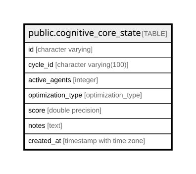

# public.cognitive_core_state

## Columns

| Name | Type | Default | Nullable | Children | Parents | Comment |
| ---- | ---- | ------- | -------- | -------- | ------- | ------- |
| id | character varying | gen_random_uuid() | false |  |  |  |
| cycle_id | character varying(100) |  | false |  |  |  |
| active_agents | integer | 0 | false |  |  |  |
| optimization_type | optimization_type |  | false |  |  |  |
| score | double precision |  | false |  |  |  |
| notes | text |  | true |  |  |  |
| created_at | timestamp with time zone | now() | false |  |  |  |

## Viewpoints

| Name | Definition |
| ---- | ---------- |
| [public schema](viewpoint-schema-public.md) | All mapped relations in public. |

## Constraints

| Name | Type | Definition |
| ---- | ---- | ---------- |
| cognitive_core_state_pkey | PRIMARY KEY | PRIMARY KEY (id) |

## Indexes

| Name | Definition |
| ---- | ---------- |
| cognitive_core_state_created_at_idx | CREATE INDEX cognitive_core_state_created_at_idx ON public.cognitive_core_state USING btree (created_at) |
| cognitive_core_state_cycle_id_idx | CREATE INDEX cognitive_core_state_cycle_id_idx ON public.cognitive_core_state USING btree (cycle_id) |
| cognitive_core_state_pkey | CREATE UNIQUE INDEX cognitive_core_state_pkey ON public.cognitive_core_state USING btree (id) |

## Relations

---

> Generated by [tbls](https://github.com/k1LoW/tbls)
