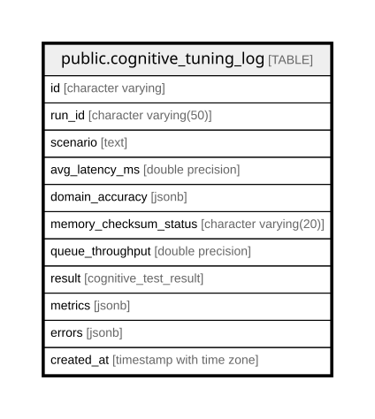

# public.cognitive_tuning_log

## Columns

| Name | Type | Default | Nullable | Children | Parents | Comment |
| ---- | ---- | ------- | -------- | -------- | ------- | ------- |
| id | character varying | gen_random_uuid() | false |  |  |  |
| run_id | character varying(50) |  | false |  |  |  |
| scenario | text |  | false |  |  |  |
| avg_latency_ms | double precision |  | true |  |  |  |
| domain_accuracy | jsonb |  | true |  |  |  |
| memory_checksum_status | character varying(20) |  | true |  |  |  |
| queue_throughput | double precision |  | true |  |  |  |
| result | cognitive_test_result |  | false |  |  |  |
| metrics | jsonb |  | true |  |  |  |
| errors | jsonb |  | true |  |  |  |
| created_at | timestamp with time zone | now() | false |  |  |  |

## Viewpoints

| Name | Definition |
| ---- | ---------- |
| [public schema](viewpoint-schema-public.md) | All mapped relations in public. |

## Constraints

| Name | Type | Definition |
| ---- | ---- | ---------- |
| cognitive_tuning_log_pkey | PRIMARY KEY | PRIMARY KEY (id) |

## Indexes

| Name | Definition |
| ---- | ---------- |
| cognitive_tuning_log_created_at_idx | CREATE INDEX cognitive_tuning_log_created_at_idx ON public.cognitive_tuning_log USING btree (created_at) |
| cognitive_tuning_log_pkey | CREATE UNIQUE INDEX cognitive_tuning_log_pkey ON public.cognitive_tuning_log USING btree (id) |
| cognitive_tuning_log_result_idx | CREATE INDEX cognitive_tuning_log_result_idx ON public.cognitive_tuning_log USING btree (result) |
| cognitive_tuning_log_run_id_idx | CREATE INDEX cognitive_tuning_log_run_id_idx ON public.cognitive_tuning_log USING btree (run_id) |
| cognitive_tuning_log_scenario_idx | CREATE INDEX cognitive_tuning_log_scenario_idx ON public.cognitive_tuning_log USING btree (scenario) |

## Relations

---

> Generated by [tbls](https://github.com/k1LoW/tbls)
