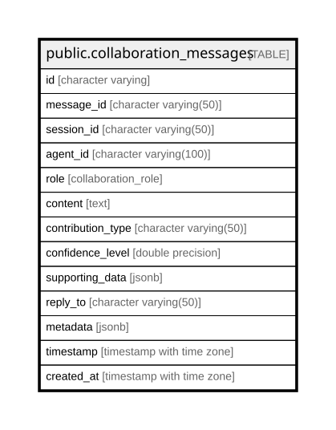

# public.collaboration_messages

## Columns

| Name | Type | Default | Nullable | Children | Parents | Comment |
| ---- | ---- | ------- | -------- | -------- | ------- | ------- |
| id | character varying | gen_random_uuid() | false |  |  |  |
| message_id | character varying(50) |  | false |  |  |  |
| session_id | character varying(50) |  | false |  |  |  |
| agent_id | character varying(100) |  | false |  |  |  |
| role | collaboration_role |  | false |  |  |  |
| content | text |  | false |  |  |  |
| contribution_type | character varying(50) |  | true |  |  |  |
| confidence_level | double precision |  | true |  |  |  |
| supporting_data | jsonb |  | true |  |  |  |
| reply_to | character varying(50) |  | true |  |  |  |
| metadata | jsonb |  | true |  |  |  |
| timestamp | timestamp with time zone | now() | false |  |  |  |
| created_at | timestamp with time zone | now() | false |  |  |  |

## Viewpoints

| Name | Definition |
| ---- | ---------- |
| [public schema](viewpoint-schema-public.md) | All mapped relations in public. |

## Constraints

| Name | Type | Definition |
| ---- | ---- | ---------- |
| collaboration_messages_message_id_key | UNIQUE | UNIQUE (message_id) |
| collaboration_messages_pkey | PRIMARY KEY | PRIMARY KEY (id) |

## Indexes

| Name | Definition |
| ---- | ---------- |
| collaboration_messages_agent_id_idx | CREATE INDEX collaboration_messages_agent_id_idx ON public.collaboration_messages USING btree (agent_id) |
| collaboration_messages_message_id_idx | CREATE INDEX collaboration_messages_message_id_idx ON public.collaboration_messages USING btree (message_id) |
| collaboration_messages_message_id_key | CREATE UNIQUE INDEX collaboration_messages_message_id_key ON public.collaboration_messages USING btree (message_id) |
| collaboration_messages_pkey | CREATE UNIQUE INDEX collaboration_messages_pkey ON public.collaboration_messages USING btree (id) |
| collaboration_messages_session_id_idx | CREATE INDEX collaboration_messages_session_id_idx ON public.collaboration_messages USING btree (session_id) |
| collaboration_messages_timestamp_idx | CREATE INDEX collaboration_messages_timestamp_idx ON public.collaboration_messages USING btree ("timestamp") |

## Relations

---

> Generated by [tbls](https://github.com/k1LoW/tbls)
