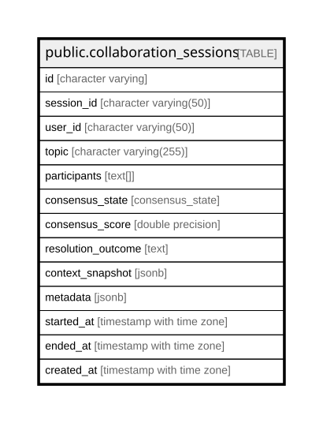

# public.collaboration_sessions

## Columns

| Name | Type | Default | Nullable | Children | Parents | Comment |
| ---- | ---- | ------- | -------- | -------- | ------- | ------- |
| id | character varying | gen_random_uuid() | false |  |  |  |
| session_id | character varying(50) |  | false |  |  |  |
| user_id | character varying(50) |  | true |  |  |  |
| topic | character varying(255) |  | false |  |  |  |
| participants | text[] |  | false |  |  |  |
| consensus_state | consensus_state | 'forming'::consensus_state | false |  |  |  |
| consensus_score | double precision |  | true |  |  |  |
| resolution_outcome | text |  | true |  |  |  |
| context_snapshot | jsonb |  | true |  |  |  |
| metadata | jsonb |  | true |  |  |  |
| started_at | timestamp with time zone | now() | false |  |  |  |
| ended_at | timestamp with time zone |  | true |  |  |  |
| created_at | timestamp with time zone | now() | false |  |  |  |

## Viewpoints

| Name | Definition |
| ---- | ---------- |
| [public schema](viewpoint-schema-public.md) | All mapped relations in public. |

## Constraints

| Name | Type | Definition |
| ---- | ---- | ---------- |
| collaboration_sessions_pkey | PRIMARY KEY | PRIMARY KEY (id) |
| collaboration_sessions_session_id_key | UNIQUE | UNIQUE (session_id) |

## Indexes

| Name | Definition |
| ---- | ---------- |
| collaboration_sessions_consensus_state_idx | CREATE INDEX collaboration_sessions_consensus_state_idx ON public.collaboration_sessions USING btree (consensus_state) |
| collaboration_sessions_pkey | CREATE UNIQUE INDEX collaboration_sessions_pkey ON public.collaboration_sessions USING btree (id) |
| collaboration_sessions_session_id_idx | CREATE INDEX collaboration_sessions_session_id_idx ON public.collaboration_sessions USING btree (session_id) |
| collaboration_sessions_session_id_key | CREATE UNIQUE INDEX collaboration_sessions_session_id_key ON public.collaboration_sessions USING btree (session_id) |
| collaboration_sessions_started_at_idx | CREATE INDEX collaboration_sessions_started_at_idx ON public.collaboration_sessions USING btree (started_at) |
| collaboration_sessions_user_id_idx | CREATE INDEX collaboration_sessions_user_id_idx ON public.collaboration_sessions USING btree (user_id) |

## Relations

---

> Generated by [tbls](https://github.com/k1LoW/tbls)
